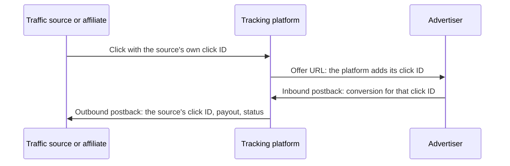

# Affiliate postback macros

**The S2S postback reference to keep open while wiring conversions: macros, parameters, signatures and reversal rules for 8 tracking platforms and 30 offerwall and survey networks, each fact linked to the vendor's own docs.**

[](https://github.com/moonetix/affiliate-postback-macros/actions/workflows/ci.yml)
[](LICENSE)
[](data/macros.json)
[](#how-to-read-the-sheet)
[](https://moonetix.com)
[](https://moonetix.github.io/affiliate-postback-macros/)

Maintained by [Moonetix](https://moonetix.com).

Every platform names the same handful of things differently. The click ID is `{transaction_id}` on Everflow, `#reqid#` on CAKE and `{clickid}` on Voluum. A reversal is `status=2` on one offerwall, `is_chargeback=1` with an `r-` prefix on another, and not documented at all on a third. This sheet puts them side by side. The same content is in [data/macros.json](data/macros.json), validated against [a JSON schema](data/macros.schema.json), so you can feed it into your own tooling. To search it or assemble an example postback URL in the browser, open the [live demo](https://moonetix.github.io/affiliate-postback-macros/).

The click ID macro for the offer URL and the payout macro for the outbound postback, per tracker, straight from the JSON:

```sh
curl -s https://raw.githubusercontent.com/moonetix/affiliate-postback-macros/main/data/macros.json | jq -r '
  .tracking_platforms[] | [.name,
    ([.macros[] | select(.direction == "click_url" and .concept == "click_id")][0].macro),
    ([.macros[] | select(.direction == "outbound" and .concept == "amount")][0].macro)] | @tsv'
```

```text
Affise    {clickid}         {sum}
BeMob     {clickId}         {payout}
Binom     {clickid}         {payout}
CAKE      #reqid#           #price#
...
```

## Contents

- [How to read the sheet](#how-to-read-the-sheet)
- [Part A: Tracking platforms](#part-a-tracking-platforms)
- [Part B: Offerwall publisher postbacks](#part-b-offerwall-publisher-postbacks)
- [Part C: Cross-platform mapping](#part-c-cross-platform-mapping)
- [Wiring notes](#wiring-notes)
- [Using the data](#using-the-data)
- [How the sheet stays current](#how-the-sheet-stays-current)
- [Not covered yet](#not-covered-yet)
- [About Moonetix](#about-moonetix)

## How to read the sheet

Conversion data moves in three directions, and the tables label each macro with one of them:

| Label | Who calls whom | Example |
| --- | --- | --- |
| **Offer URL** | The platform adds its click ID to the advertiser's landing URL. | `https://offer.example/?s2={clickid}` |
| **Inbound postback** | The advertiser or network reports the conversion back to the platform, server to server. | `https://tracker.example/postback?cid=...&payout=...` |
| **Outbound postback** | The platform passes the conversion on to its affiliate or traffic source. | `https://source.example/conv?click={externalid}` |



Part B covers the last hop for rewards publishers: the offerwall network calling your server so you can credit a user.

- Every row links the vendor page it comes from. All pages were read in November 2026.
- **n/d** means not documented on the linked pages. The feature may exist; we could not cite it, so it is not listed.
- Inbound parameter names are shown bare (`cid`). Macros are shown with the vendor's own delimiters (`{clickid}`, `#s2#`, `[%TX%]`, `{{userId}}`).
- Vendors change their docs. If a row is out of date, open an issue with the link to the current page.

## Part A: Tracking platforms

Affiliate network platforms (Affise, CAKE, Everflow) and media buying trackers (BeMob, Binom, Keitaro, RedTrack, Voluum), in alphabetical order.

<!-- part-a:start -->

### Inbound postback formats

The URL an advertiser or network calls to report a conversion to the platform.

| Platform | Method | Example from the vendor docs | Source |
| --- | --- | --- | --- |
| [Affise](#affise) | GET or POST | `https://abbbc.affise.com/postback?clickid={clickid}&pid={pub_id}` | [docs](https://help-center.affise.com/en/articles/6474604-set-up-s2s-integration-with-advertisers), checked November 2026 |
| [BeMob](#bemob) | GET | `https://xxxxx.bemobtrk.com/postback?cid=REPLACE&payout=OPTIONAL&txid=REPLACE&status=REPLACE` | [docs](https://docs.bemob.com/en/postback-settings-of-affiliate-network), checked November 2026 |
| [Binom](#binom) | GET | `https://binom.org/click?cnv_id={sub1}&payout={sum}&cnv_status={status}` | [docs](https://docs.binom.org/postback-v2.php), checked November 2026 |
| [CAKE](#cake) | GET | `https://demo-new.cakemarketing.com/p.ashx?o=976&e=ld&f=pb&r=REQUEST_SESSION_ID&t=TRANSACTION_ID` | [docs](https://support.getcake.com/support/solutions/articles/5000546408-how-to-implement-server-to-server-tracking-using-a-postback-url), checked November 2026 |
| [Everflow](#everflow) | GET | `https://trk.example.com/?nid=123&transaction_id={transaction_id}&amount=99.99&currency=USD` | [docs](https://helpdesk.everflow.io/customer/accessing-editing-s2s-postback-urls), checked November 2026 |
| [Keitaro](#keitaro) | GET | `http://IP/postback-key/postback?subid=REPLACE&status=REPLACE&payout=REPLACE` | [docs](https://docs.keitaro.io/en/conversions-and-postback/postback.html), checked November 2026 |
| [RedTrack](#redtrack) | GET | `https://your.dedicated.tracking.domain.com/postback?clickid={affiliate_network_parameter}` | [docs](https://help.redtrack.io/?p=423), checked November 2026 |
| [Voluum](#voluum) | GET | `https://voluum_dedicated_domain.com/postback?cid=REPLACE&payout=OPTIONAL&txid=OPTIONAL` | [docs](https://doc.voluum.com/en/submitting_postback_url.html), checked November 2026 |

### How inbound postbacks are secured

None of these platforms documents an HMAC signature on inbound postbacks. Protection is a shared token, an IP allowlist, or both.

| Platform | Mechanisms | Duplicates |
| --- | --- | --- |
| Affise | **Secure code.** Sent in the secure parameter. A wrong or missing code is answered with Access denied. [docs](https://help-center.affise.com/en/articles/6476587-server-postback-errors)<br>**IP allowlist.** Set at offer or advertiser level. Other addresses get Bad IP. [docs](https://help-center.affise.com/en/articles/6476587-server-postback-errors) | A postback for a conversion that already exists is answered with Conversion exists. The page does not say which field is the key. [docs](https://help-center.affise.com/en/articles/6476587-server-postback-errors) |
| BeMob | **IP allowlist.** Accept postbacks only from listed addresses, one per line. [docs](https://help.bemob.com/docs/double-postbacks-and-postbacks-from-white-ips) | Repeat postbacks for the same click ID are not accepted by default unless a payout, unique transaction ID or status value sets them apart. Accept Double Postbacks turns this off. [docs](https://help.bemob.com/docs/double-postbacks-and-postbacks-from-white-ips) |
| Binom | **IP allowlist.** Postback IP whitelist field on the affiliate network. [docs](https://docs.binom.org/affiliate-networks.php) | With Upsell checked on an offer, payouts of several postbacks for the same click ID are summed instead of replaced. [docs](https://docs.binom.org/postback-v2.php) |
| CAKE | **IP allowlist.** Advertiser pixel whitelist with an IP start and end. Conversions From Whitelist Only on the offer stores conversions from those servers only. [docs](https://support.getcake.com/support/solutions/articles/5000545795-how-to-whitelist-conversion-pixel-ip-addresses) | n/d |
| Everflow | **Verification token.** verification_token, up to 50 characters, case-sensitive, set per advertiser. Once enabled it is required on every postback for that advertiser's offers. [docs](https://helpdesk.everflow.io/customer/accessing-editing-s2s-postback-urls)<br>**IP or domain allowlist.** Set per advertiser, enforced per offer with Enforce Advertiser Whitelist. Ranges and wildcards are not allowed. [docs](https://helpdesk.everflow.io/customer/ip-domain-whitelisting-for-advertisers) | Turn off Allow Duplicate Conversions on the offer and send a unique order_id. [docs](https://helpdesk.everflow.io/customer/accessing-editing-s2s-postback-urls) |
| Keitaro | **Postback key.** A unique key in the postback path protects the tracker from fake postback requests. Self-hosted installs change it with TRACKER_POSTBACK_KEY. [docs](https://docs.keitaro.io/en/conversions-and-postback/postback.html) | A second postback with the same status overwrites the earlier conversion. Send a unique tid to keep them separate. [docs](https://docs.keitaro.io/en/conversions-and-postback/postback.html) |
| RedTrack | **Postback protection.** A toggle on the offer source adds a unique ptoken to the postback template. Conversions with a non-matching ptoken are ignored. [docs](https://help.redtrack.io/knowledgebase/kb/basic-setup-9785/offer-sources-brand-related-settings-9830/postback-protection/)<br>**IP allowlist.** Whitelist IP records conversions only from a given IP or range. [docs](https://help.redtrack.io/knowledgebase/kb/basic-setup-9785/offer-sources-brand-related-settings-9830/postback-protection/) | Duplicate postback mode per offer source, including Ignore duplicate postbacks and Ignore duplicate postbacks by event id (rdtk_event_id). [docs](https://help.redtrack.io/knowledgebase/tracking-event-types/) |
| Voluum | **IP allowlist.** Inbound postbacks from IPs that are not allowlisted are discarded. Does not work while IP anonymization is on. [docs](https://doc.voluum.com/article/add-an-affiliate-network-to-voluum) | Duplicate click IDs are discarded. The same cid and txid pair counts once. Accept duplicate postbacks keeps repeats with an empty txid. [docs](https://doc.voluum.com/article/upselling-tracking-subsequent-conversions) |

### Affise

Network platform. [affise.com](https://affise.com). Sources checked November 2026.

Inbound postback (GET or POST):

```text
https://abbbc.affise.com/postback?clickid={clickid}&pid={pub_id}
```

The advertiser receives the click ID in the tracking link, for example aff_sub={clickid}, and returns it as clickid. [docs](https://help-center.affise.com/en/articles/6474604-set-up-s2s-integration-with-advertisers)

| Where | Concept | Macro or parameter | Notes | Source |
| --- | --- | --- | --- | --- |
| Inbound postback | Click ID | `clickid` | Also click_id. Mandatory. | [docs](https://help-center.affise.com/en/articles/6475468-affise-postback-url-parameters) |
| Inbound postback | Transaction ID | `action_id` | Conversion ID in the advertiser's system. | [docs](https://help-center.affise.com/en/articles/6475468-affise-postback-url-parameters) |
| Inbound postback | Payout or revenue | `sum` | Revenue. | [docs](https://help-center.affise.com/en/articles/6475468-affise-postback-url-parameters) |
| Inbound postback | Status | `status` | 1 approved, 2 pending, 3 declined, 5 hold. | [docs](https://help-center.affise.com/en/articles/6475468-affise-postback-url-parameters) |
| Inbound postback | Event or goal | `goal` |  | [docs](https://help-center.affise.com/en/articles/6475468-affise-postback-url-parameters) |
| Inbound postback | IP address | `ip` |  | [docs](https://help-center.affise.com/en/articles/6475468-affise-postback-url-parameters) |
| Inbound postback | Time | `action_timestamp` |  | [docs](https://help-center.affise.com/en/articles/6475468-affise-postback-url-parameters) |
| Inbound postback | Security | `secure` | Secure code set at offer, advertiser or platform level. | [docs](https://help-center.affise.com/en/articles/6475468-affise-postback-url-parameters) |
| Inbound postback | Other | `custom_field1 ... custom_field15` |  | [docs](https://help-center.affise.com/en/articles/6475468-affise-postback-url-parameters) |
| Offer URL | Click ID | `{clickid}` | Also {click_id}. Required in the advertiser tracking URL. | [docs](https://help-center.affise.com/en/articles/6474898-advertiser-tracking-url-macros) |
| Offer URL | Affiliate ID | `{pid}` |  | [docs](https://help-center.affise.com/en/articles/6474898-advertiser-tracking-url-macros) |
| Offer URL | Offer ID | `{offer_id}` |  | [docs](https://help-center.affise.com/en/articles/6474898-advertiser-tracking-url-macros) |
| Offer URL | Sub ID | `{sub1} ... {sub8}` |  | [docs](https://help-center.affise.com/en/articles/6474898-advertiser-tracking-url-macros) |
| Offer URL | Country | `{geo}` | ISO alpha-2. | [docs](https://help-center.affise.com/en/articles/6474898-advertiser-tracking-url-macros) |
| Outbound postback | Partner click ID | `{sub1} ... {sub8}` | Affise has no clickid macro for affiliate postbacks. Pass your click ID in a sub and read it back. | [docs](https://help-center.affise.com/en/articles/6483741-affiliate-postback-url-macros) |
| Outbound postback | Sub ID | `{sub1} ... {sub8}` |  | [docs](https://help-center.affise.com/en/articles/6483741-affiliate-postback-url-macros) |
| Outbound postback | Payout or revenue | `{sum}` | Conversion payout. | [docs](https://help-center.affise.com/en/articles/6483741-affiliate-postback-url-macros) |
| Outbound postback | Sale amount | `{order_sum}` |  | [docs](https://help-center.affise.com/en/articles/6483741-affiliate-postback-url-macros) |
| Outbound postback | Status | `{status}` | 1 approved, 2 pending, 3 declined, 5 hold. | [docs](https://help-center.affise.com/en/articles/6483741-affiliate-postback-url-macros) |
| Outbound postback | Transaction ID | `{transactionid}` | The advertiser's conversion identifier. | [docs](https://help-center.affise.com/en/articles/6483741-affiliate-postback-url-macros) |
| Outbound postback | Offer ID | `{offerid}` | No underscore here, unlike {offer_id} in tracking URLs. | [docs](https://help-center.affise.com/en/articles/6483741-affiliate-postback-url-macros) |
| Outbound postback | Currency | `{currency}` |  | [docs](https://help-center.affise.com/en/articles/6483741-affiliate-postback-url-macros) |
| Outbound postback | IP address | `{ip}` |  | [docs](https://help-center.affise.com/en/articles/6483741-affiliate-postback-url-macros) |
| Outbound postback | Country | `{geo}` |  | [docs](https://help-center.affise.com/en/articles/6483741-affiliate-postback-url-macros) |
| Outbound postback | Time | `{timestamp}` | Unix time of conversion creation. | [docs](https://help-center.affise.com/en/articles/6483741-affiliate-postback-url-macros) |
| Outbound postback | Event or goal | `{goal}` |  | [docs](https://help-center.affise.com/en/articles/6483741-affiliate-postback-url-macros) |

**Not documented on the pages above:** HMAC signing; Currency parameter on inbound postbacks.

### BeMob

Tracker. [bemob.com](https://bemob.com). Sources checked November 2026.

Inbound postback (GET):

```text
https://xxxxx.bemobtrk.com/postback?cid=REPLACE&payout=OPTIONAL&txid=REPLACE&status=REPLACE
```

cid is the only required parameter. BeMob click IDs are 22 alphanumeric characters. [docs](https://docs.bemob.com/en/postback-settings-of-affiliate-network)

| Where | Concept | Macro or parameter | Notes | Source |
| --- | --- | --- | --- | --- |
| Inbound postback | Click ID | `cid` | Required. | [docs](https://docs.bemob.com/en/postback-settings-of-affiliate-network) |
| Inbound postback | Payout or revenue | `payout` |  | [docs](https://docs.bemob.com/en/postback-settings-of-affiliate-network) |
| Inbound postback | Transaction ID | `txid` | Unique per conversion, for example an order number. | [docs](https://docs.bemob.com/en/postback-settings-of-affiliate-network) |
| Inbound postback | Status | `status` | You map the network's values to New, Approved, Declined or Chargeback. | [docs](https://docs.bemob.com/en/postback-statuses) |
| Inbound postback | Event or goal | `cet` | Custom conversion type. | [docs](https://docs.bemob.com/en/postback-statuses) |
| Offer URL | Click ID | `{clickId}` | Example: subid={clickId}. | [docs](https://docs.bemob.com/en/offer-settings) |
| Outbound postback | Partner click ID | `{externalId}` |  | [docs](https://help.bemob.com/docs/postback-settings-of-a-traffic-source) |
| Outbound postback | Payout or revenue | `{payout}` | Account currency. {payout.USD} converts. | [docs](https://help.bemob.com/docs/postback-settings-of-a-traffic-source) |
| Outbound postback | Transaction ID | `{transactionId}` |  | [docs](https://help.bemob.com/docs/postback-settings-of-a-traffic-source) |
| Outbound postback | Status | `{status}` |  | [docs](https://help.bemob.com/docs/send-postbacks-for-selected-statuses) |
| Outbound postback | Sub ID | `{custom1} ... {customN}` |  | [docs](https://help.bemob.com/docs/postback-settings-of-a-traffic-source) |
| Outbound postback | Offer ID | `{offerId}` |  | [docs](https://help.bemob.com/docs/postback-settings-of-a-traffic-source) |
| Outbound postback | Campaign ID | `{campaignId}` |  | [docs](https://help.bemob.com/docs/postback-settings-of-a-traffic-source) |
| Outbound postback | IP address | `{ip}` |  | [docs](https://help.bemob.com/docs/postback-settings-of-a-traffic-source) |
| Outbound postback | Country | `{country}` | Also {countryCode}. | [docs](https://help.bemob.com/docs/postback-settings-of-a-traffic-source) |

**Not documented on the pages above:** HMAC signing or a secret token; Currency parameter on inbound postbacks.

### Binom

Tracker. [binom.org](https://binom.org). Sources checked November 2026.

Inbound postback (GET):

```text
https://binom.org/click?cnv_id={sub1}&payout={sum}&cnv_status={status}
```

The values in braces are the network's own macros. click is the tracker file that handles clicks and conversions. [docs](https://docs.binom.org/postback-v2.php)

| Where | Concept | Macro or parameter | Notes | Source |
| --- | --- | --- | --- | --- |
| Inbound postback | Click ID | `cnv_id` |  | [docs](https://docs.binom.org/postback-v2.php) |
| Inbound postback | Payout or revenue | `payout` |  | [docs](https://docs.binom.org/postback-v2.php) |
| Inbound postback | Status | `cnv_status` | Free text. A second field, cnv_status2, also exists. | [docs](https://docs.binom.org/postback-v2.php) |
| Inbound postback | Currency | `cnv_currency` |  | [docs](https://docs.binom.org/postback-v2.php) |
| Inbound postback | Other | `disable_postback=1` | Do not fire the postback to the traffic source for this conversion. | [docs](https://docs.binom.org/postback-v2.php) |
| Offer URL | Click ID | `{clickid}` | Example: {offer_url}?sub1={clickid}. | [docs](https://docs.binom.org/affiliate-networks.php) |
| Outbound postback | Partner click ID | `{externalid}` |  | [docs](https://docs.binom.org/conv-to-source.php) |
| Outbound postback | Payout or revenue | `{payout}` | Payout in USD. | [docs](https://docs.binom.org/conv-to-source.php) |
| Outbound postback | Status | `{cnv_status}` | Also {status}. | [docs](https://docs.binom.org/tokens-v2.php) |
| Outbound postback | Currency | `{cnv_currency}` |  | [docs](https://docs.binom.org/conv-to-source.php) |
| Outbound postback | Sub ID | `{t1} ... {t10}` | Traffic source tokens. | [docs](https://docs.binom.org/conv-to-source.php) |
| Outbound postback | Offer ID | `{offer}` | The tokens page lists {offer_id}. | [docs](https://docs.binom.org/conv-to-source.php) |
| Outbound postback | Campaign ID | `{campaign}` |  | [docs](https://docs.binom.org/conv-to-source.php) |
| Outbound postback | IP address | `{ip}` |  | [docs](https://docs.binom.org/tokens-v2.php) |
| Outbound postback | Country | `{country}` | Also {country_code}. | [docs](https://docs.binom.org/tokens-v2.php) |

**Not documented on the pages above:** HMAC signing or a secret token; Transaction ID parameter on inbound postbacks; Conversion ID macro on outbound postbacks.

### CAKE

Network platform. [getcake.com](https://getcake.com). Sources checked November 2026.

Inbound postback (GET):

```text
https://demo-new.cakemarketing.com/p.ashx?o=976&e=ld&f=pb&r=REQUEST_SESSION_ID&t=TRANSACTION_ID
```

Replace REQUEST_SESSION_ID with the advertiser's token for the parameter that received #reqid#, for example #s2#. The page does not define o, e and f. [docs](https://support.getcake.com/support/solutions/articles/5000546408-how-to-implement-server-to-server-tracking-using-a-postback-url)

| Where | Concept | Macro or parameter | Notes | Source |
| --- | --- | --- | --- | --- |
| Inbound postback | Click ID | `r` | Request Session ID. | [docs](https://support.getcake.com/support/solutions/articles/5000546408-how-to-implement-server-to-server-tracking-using-a-postback-url) |
| Inbound postback | Transaction ID | `t` | Shown as t=TRANSACTION_ID in the example. | [docs](https://support.getcake.com/support/solutions/articles/5000546408-how-to-implement-server-to-server-tracking-using-a-postback-url) |
| Inbound postback | Payout or revenue | `p` | Price. Overrides the offer's received amount. | [docs](https://support.getcake.com/support/solutions/articles/5000545957-how-to-set-up-a-revshare) |
| Offer URL | Click ID | `#reqid#` | Example: ?s2=#reqid#. | [docs](https://support.getcake.com/support/solutions/articles/5000546408-how-to-implement-server-to-server-tracking-using-a-postback-url) |
| Outbound postback | Partner click ID | `#s2#` | Example from CAKE: click_id=#s2#. s1 is reserved for the affiliate's sub-affiliate ID. | [docs](https://support.getcake.com/support/solutions/articles/5000546096-how-affiliates-can-use-tokens-to-send-dynamic-values-in-pixels) |
| Outbound postback | Sub ID | `#s1# ... #s5#` |  | [docs](https://support.getcake.com/support/articles/5000546436-tokens-in-3rd-party-affiliate-pixels-cake-basic) |
| Outbound postback | Payout or revenue | `#price#` |  | [docs](https://support.getcake.com/support/articles/5000546436-tokens-in-3rd-party-affiliate-pixels-cake-basic) |
| Outbound postback | Transaction ID | `#leadid#` |  | [docs](https://support.getcake.com/support/articles/5000546436-tokens-in-3rd-party-affiliate-pixels-cake-basic) |
| Outbound postback | Offer ID | `#oid#` |  | [docs](https://support.getcake.com/support/articles/5000546436-tokens-in-3rd-party-affiliate-pixels-cake-basic) |
| Outbound postback | Campaign ID | `#campid#` |  | [docs](https://support.getcake.com/support/articles/5000546436-tokens-in-3rd-party-affiliate-pixels-cake-basic) |
| Outbound postback | Affiliate ID | `#affid#` |  | [docs](https://support.getcake.com/support/articles/5000546436-tokens-in-3rd-party-affiliate-pixels-cake-basic) |
| Outbound postback | IP address | `#ip#` | Conversion IP. #source_ip# is the click IP. | [docs](https://support.getcake.com/support/articles/5000546436-tokens-in-3rd-party-affiliate-pixels-cake-basic) |
| Outbound postback | Time | `#utcunixtime#` |  | [docs](https://support.getcake.com/support/articles/5000546436-tokens-in-3rd-party-affiliate-pixels-cake-basic) |

**Not documented on the pages above:** HMAC signing or a secret token; Status parameter; Duplicate handling on the pages we could read.

### Everflow

Network platform. [everflow.io](https://www.everflow.io). Sources checked November 2026.

Inbound postback (GET):

```text
https://trk.example.com/?nid=123&transaction_id={transaction_id}&amount=99.99&currency=USD
```

nid (your network ID) and transaction_id are required. Everflow accepts GET requests only. [docs](https://helpdesk.everflow.io/customer/accessing-editing-s2s-postback-urls)

| Where | Concept | Macro or parameter | Notes | Source |
| --- | --- | --- | --- | --- |
| Inbound postback | Click ID | `transaction_id` | Required. | [docs](https://helpdesk.everflow.io/customer/accessing-editing-s2s-postback-urls) |
| Inbound postback | Payout or revenue | `amount` |  | [docs](https://helpdesk.everflow.io/customer/accessing-editing-s2s-postback-urls) |
| Inbound postback | Currency | `currency` | Three-letter ISO code. | [docs](https://helpdesk.everflow.io/customer/accessing-editing-s2s-postback-urls) |
| Inbound postback | Transaction ID | `order_id` | Used for deduplication. | [docs](https://helpdesk.everflow.io/customer/accessing-editing-s2s-postback-urls) |
| Inbound postback | Event or goal | `event_id` | Also adv_event_id. | [docs](https://helpdesk.everflow.io/customer/accessing-editing-s2s-postback-urls) |
| Inbound postback | Time | `timestamp` | Unix, UTC. | [docs](https://helpdesk.everflow.io/customer/accessing-editing-s2s-postback-urls) |
| Inbound postback | Security | `verification_token` |  | [docs](https://helpdesk.everflow.io/customer/accessing-editing-s2s-postback-urls) |
| Inbound postback | Other | `adv1 ... adv10` | Custom names are ignored. | [docs](https://helpdesk.everflow.io/customer/accessing-editing-s2s-postback-urls) |
| Offer URL | Click ID | `{transaction_id}` | Example: click_id={transaction_id} in the Default Landing Page. | [docs](https://helpdesk.everflow.io/customer/your-guide-to-parameters-macros) |
| Offer URL | Offer ID | `{offer_id}` |  | [docs](https://helpdesk.everflow.io/customer/your-guide-to-parameters-macros) |
| Offer URL | Affiliate ID | `{affiliate_id}` |  | [docs](https://helpdesk.everflow.io/customer/your-guide-to-parameters-macros) |
| Outbound postback | Partner click ID | `{sub1}` | Commonly used for the partner's click ID. | [docs](https://helpdesk.everflow.io/customer/your-guide-to-parameters-macros) |
| Outbound postback | Sub ID | `{sub1} ... {sub10}` | Slots 6 to 10 were added in May 2026. | [docs](https://helpdesk.everflow.io/collaborator/managing-postbacks-as-a-partner) |
| Outbound postback | Payout or revenue | `{payout_amount}` | In the offer currency. The partner help article names this macro {payout}. | [docs](https://helpdesk.everflow.io/customer/your-guide-to-parameters-macros) |
| Outbound postback | Sale amount | `{sale_amount}` | Visible to partners only if the network enables it. | [docs](https://helpdesk.everflow.io/customer/your-guide-to-parameters-macros) |
| Outbound postback | Transaction ID | `{conversion_id}` |  | [docs](https://helpdesk.everflow.io/customer/your-guide-to-parameters-macros) |
| Outbound postback | Offer ID | `{offer_id}` |  | [docs](https://helpdesk.everflow.io/customer/your-guide-to-parameters-macros) |
| Outbound postback | Affiliate ID | `{affiliate_id}` |  | [docs](https://helpdesk.everflow.io/customer/your-guide-to-parameters-macros) |
| Outbound postback | Currency | `{offer_currency}` |  | [docs](https://helpdesk.everflow.io/customer/your-guide-to-parameters-macros) |
| Outbound postback | IP address | `{session_ip}` | {conversion_ip} is the IP at conversion. | [docs](https://helpdesk.everflow.io/customer/your-guide-to-parameters-macros) |
| Outbound postback | Country | `{geo_country_code}` | ISO 3166-1 alpha-2. | [docs](https://helpdesk.everflow.io/customer/your-guide-to-parameters-macros) |
| Outbound postback | Time | `{timestamp}` | Unix, UTC. | [docs](https://helpdesk.everflow.io/customer/your-guide-to-parameters-macros) |
| Outbound postback | Event or goal | `{event_id}` |  | [docs](https://helpdesk.everflow.io/customer/your-guide-to-parameters-macros) |

**Delivery.** Partner postbacks: up to 5 attempts, any 2xx counts as success. A postback is deactivated after at least 10 consecutive failures spanning more than 72 hours. [docs](https://helpdesk.everflow.io/collaborator/managing-postbacks-as-a-partner)

**Not documented on the pages above:** HMAC signing; Status macro.

### Keitaro

Tracker. [keitaro.io](https://keitaro.io). Sources checked November 2026.

Inbound postback (GET):

```text
http://IP/postback-key/postback?subid=REPLACE&status=REPLACE&payout=REPLACE
```

The postback key in the path authenticates the request. subid and status are mandatory. [docs](https://docs.keitaro.io/en/conversions-and-postback/postback.html)

| Where | Concept | Macro or parameter | Notes | Source |
| --- | --- | --- | --- | --- |
| Inbound postback | Click ID | `subid` | Mandatory. | [docs](https://docs.keitaro.io/en/conversions-and-postback/postback.html) |
| Inbound postback | Status | `status` | Mandatory. lead, sale, rejected, registration, deposit, trash, or custom. Unknown values are ignored and logged. | [docs](https://docs.keitaro.io/en/conversions-and-postback/postback.html) |
| Inbound postback | Payout or revenue | `payout` | Positive and negative values are supported. | [docs](https://docs.keitaro.io/en/conversions-and-postback/postback.html) |
| Inbound postback | Transaction ID | `tid` | Records repeat conversions without overwriting the previous one. | [docs](https://docs.keitaro.io/en/conversions-and-postback/postback.html) |
| Inbound postback | Currency | `currency` |  | [docs](https://docs.keitaro.io/en/conversions-and-postback/postback.html) |
| Inbound postback | Sub ID | `sub_id_1 ... sub_id_30` | Updates click data. | [docs](https://docs.keitaro.io/en/conversions-and-postback/postback.html) |
| Inbound postback | Other | `return` | Response text returned to the sender. | [docs](https://docs.keitaro.io/en/conversions-and-postback/postback.html) |
| Offer URL | Click ID | `{subid}` | The only required offer parameter. Example: &sub1={subid}. | [docs](https://docs.keitaro.io/en/conversions-and-postback/adding-affiliate-networks.html) |
| Outbound postback | Partner click ID | `{external_id}` |  | [docs](https://docs.keitaro.io/en/campaigns-and-streams/s2s-postback-placeholders.html) |
| Outbound postback | Click ID | `{subid}` |  | [docs](https://docs.keitaro.io/en/campaigns-and-streams/s2s-postback-placeholders.html) |
| Outbound postback | Status | `{status}` | Can be remapped, for example {status:lead=0 sale=1 rejected=2}. | [docs](https://docs.keitaro.io/en/campaigns-and-streams/s2s-postback-placeholders.html) |
| Outbound postback | Payout or revenue | `{revenue}` | Also {conversion_revenue}. | [docs](https://docs.keitaro.io/en/campaigns-and-streams/s2s-postback-placeholders.html) |
| Outbound postback | Transaction ID | `{tid}` |  | [docs](https://docs.keitaro.io/en/campaigns-and-streams/s2s-postback-placeholders.html) |
| Outbound postback | Sub ID | `{sub_id_1} ... {sub_id_30}` |  | [docs](https://docs.keitaro.io/en/campaigns-and-streams/s2s-postback-placeholders.html) |
| Outbound postback | Offer ID | `{offer_id}` |  | [docs](https://docs.keitaro.io/en/campaigns-and-streams/s2s-postback-placeholders.html) |
| Outbound postback | Campaign ID | `{campaign_id}` |  | [docs](https://docs.keitaro.io/en/campaigns-and-streams/s2s-postback-placeholders.html) |
| Outbound postback | IP address | `{ip}` |  | [docs](https://docs.keitaro.io/en/campaigns-and-streams/s2s-postback-placeholders.html) |
| Outbound postback | Country | `{country}` |  | [docs](https://docs.keitaro.io/en/campaigns-and-streams/s2s-postback-placeholders.html) |
| Outbound postback | Time | `{conversion_time:format,timezone}` |  | [docs](https://docs.keitaro.io/en/campaigns-and-streams/s2s-postback-placeholders.html) |

**Not documented on the pages above:** HMAC signing; IP allowlist.

### RedTrack

Tracker. [redtrack.io](https://www.redtrack.io). Sources checked November 2026.

Inbound postback (GET):

```text
https://your.dedicated.tracking.domain.com/postback?clickid={affiliate_network_parameter}
```

Add sum for the payout and type for the conversion type. [docs](https://help.redtrack.io/?p=423)

| Where | Concept | Macro or parameter | Notes | Source |
| --- | --- | --- | --- | --- |
| Inbound postback | Click ID | `clickid` |  | [docs](https://help.redtrack.io/?p=423) |
| Inbound postback | Payout or revenue | `sum` |  | [docs](https://help.redtrack.io/?p=9054) |
| Inbound postback | Event or goal | `type` | Conversion type, for example type=InitiateCheckout. | [docs](https://help.redtrack.io/?p=21537) |
| Inbound postback | Transaction ID | `rdtk_event_id` | Used by the duplicate mode that ignores repeats by event ID. Integration guides use eventid. | [docs](https://help.redtrack.io/knowledgebase/tracking-event-types/) |
| Inbound postback | Time | `timestamp` | Unix time. The conversion is recorded at this time. | [docs](https://help.redtrack.io/?p=423) |
| Offer URL | Click ID | `{clickid}` | Example: offer_url?affiliate_network_parameter={clickid}. | [docs](https://help.redtrack.io/?p=423) |
| Outbound postback | Partner click ID | `{ref_id}` |  | [docs](https://help.redtrack.io/knowledgebase/adding-traffic-channel/) |
| Outbound postback | Payout or revenue | `{offer_payout}` | There is no {payout} macro. | [docs](https://help.redtrack.io/knowledgebase/adding-traffic-channel/) |
| Macro list | Transaction ID | `{postbackid}` | Conversion ID. | [docs](https://help.redtrack.io/?p=423) |
| Macro list | Sub ID | `{sub1} ... {sub20}` |  | [docs](https://help.redtrack.io/?p=423) |
| Macro list | Offer ID | `{offerid}` |  | [docs](https://help.redtrack.io/?p=423) |
| Macro list | Campaign ID | `{campaignid}` |  | [docs](https://help.redtrack.io/?p=423) |
| Macro list | IP address | `{ip}` |  | [docs](https://help.redtrack.io/?p=423) |
| Macro list | Country | `{country}` |  | [docs](https://help.redtrack.io/?p=423) |

**Not documented on the pages above:** HMAC signing; Name of the inbound status parameter (statuses are other, approved, pending, declined); Currency parameter.

### Voluum

Tracker. [voluum.com](https://voluum.com). Sources checked November 2026.

Inbound postback (GET):

```text
https://voluum_dedicated_domain.com/postback?cid=REPLACE&payout=OPTIONAL&txid=OPTIONAL
```

HTTPS needs SSL enabled on your dedicated domain. [docs](https://doc.voluum.com/en/submitting_postback_url.html)

| Where | Concept | Macro or parameter | Notes | Source |
| --- | --- | --- | --- | --- |
| Inbound postback | Click ID | `cid` | Required. c is also accepted; cid wins. | [docs](https://doc.voluum.com/article/parameters-in-postback-urls) |
| Inbound postback | Payout or revenue | `payout` | p is also accepted; payout wins. | [docs](https://doc.voluum.com/article/parameters-in-postback-urls) |
| Inbound postback | Transaction ID | `txid` | Unique within the scope of one click ID. | [docs](https://doc.voluum.com/article/parameters-in-postback-urls) |
| Inbound postback | Event or goal | `et` | Conversion type. Needs custom conversions set up. | [docs](https://doc.voluum.com/article/parameters-in-postback-urls) |
| Inbound postback | Currency | `currency` | Overrides the offer currency. | [docs](https://doc.voluum.com/article/parameters-in-postback-urls) |
| Inbound postback | Other | `param1 ... param5` |  | [docs](https://doc.voluum.com/article/parameters-in-postback-urls) |
| Offer URL | Click ID | `{clickid}` | Example: https://offer_url.com?s2={clickid}. | [docs](https://doc.voluum.com/article/pass-information-to-an-affiliate-network) |
| Outbound postback | Partner click ID | `{externalid}` |  | [docs](https://doc.voluum.com/article/traffic-source-postback-url) |
| Outbound postback | Click ID | `{click.id}` |  | [docs](https://doc.voluum.com/article/traffic-source-postback-url) |
| Outbound postback | Payout or revenue | `{payout}` |  | [docs](https://doc.voluum.com/article/traffic-source-postback-url) |
| Outbound postback | Transaction ID | `{transaction.id}` |  | [docs](https://doc.voluum.com/article/traffic-source-postback-url) |
| Outbound postback | Sub ID | `{var1}, {var:name}` | Custom variables. | [docs](https://doc.voluum.com/article/traffic-source-postback-url) |
| Outbound postback | Offer ID | `{offer.id}` |  | [docs](https://doc.voluum.com/article/traffic-source-postback-url) |
| Outbound postback | Campaign ID | `{campaign.id}` |  | [docs](https://doc.voluum.com/article/traffic-source-postback-url) |
| Outbound postback | IP address | `{ip}` |  | [docs](https://doc.voluum.com/article/traffic-source-postback-url) |
| Outbound postback | Country | `{country}` | Also {countryname}. | [docs](https://doc.voluum.com/article/traffic-source-postback-url) |

**Not documented on the pages above:** HMAC signing or a secret token; Status parameter.

<!-- part-a:end -->

## Part B: Offerwall publisher postbacks

What an offerwall network sends to your server when a user earns or loses a reward, and how to prove the request is genuine.

<!-- part-b:start -->

### Signatures

| Network | Scheme | Signed input | Sent in | Key | Source |
| --- | --- | --- | --- | --- | --- |
| [Moonetix](#moonetix) | HMAC-SHA256 | transaction_id:user_id:reward:status | {hash} macro, lowercase hex | Postback secret key | [docs](https://docs.moonetix.com/postbacks#verify), checked November 2026 |
| [AdBreak Media](#adbreak-media) | SHA-256 (keyed by concatenation) | [YOUR_USER_ID] + [OFFER_ID] + [TXID] + publisher secret key | [HASH] macro | Publisher secret key from the dashboard settings (secret credentials) | [docs](https://docs.adbreakmedia.com/monetization/postback), checked November 2026 |
| [AdGate Media](#adgate-media) | None documented |  |  |  | [docs](https://docs.prodegeads.com/postbacks/postback-information), checked November 2026 |
| [AdGem](#adgem) | HMAC-SHA256 | v2: the full postback URL with the verifier parameter removed. v3: the request body. | verifier query parameter (v2); Signature header (v3) | Postback secret key | [docs](https://docs.adgem.com/docs/integrate/reward-mechanism/postbacks-v3), checked November 2026 |
| [adjoe](#adjoe) | SHA-1 (keyed by concatenation) | trans_uuid + user_uuid + currency + coin_amount + device_id + sdk_app_id + s2s_token | sid query parameter, hex | S2S token from the Monetize Dashboard payout setup | [docs](https://docs.adjoe.io/rewarded-solutions/setting-up-rewarding/server-to-server-payouts/), checked November 2026 |
| [AppsPrize (AppSamurai)](#appsprize-appsamurai) | SHA-256 (keyed by concatenation) | concatenate(trans_id, user_id, coin_amount, coin_currency, app_token, s2s_token) | sig parameter | s2s_token, generated by AppsPrize once you share your endpoint URL | [docs](https://appsamurai.com/help/appsprize-using-the-sdk/), checked November 2026 |
| [ayeT-Studios](#ayet-studios) | HMAC-SHA256 | All request parameters sorted by key, values URL-encoded (space as +), joined as a query string | X-Ayetstudios-Security-Hash header, hex | Publisher API key | [docs](https://docs.ayetstudios.com/v/product-docs/callbacks-and-testing/callback-verification/hmac-security-hash-optional), checked November 2026 |
| [Besitos](#besitos) | HMAC-SHA256 | The webhook URL as received, with the verifier parameter removed | verifier query parameter at the end of the URL | Webhook secret key from the Besitos Admin Portal | [docs](https://help.besitoscorp.com/en/articles/11106589-postback-setup), checked November 2026 |
| [BitcoTasks](#bitcotasks) | MD5 (keyed by concatenation) | subId + transId + reward + secret key | signature parameter | Secret Key of the app (My Apps) | [docs](https://bitcotasks.com/documentations#ow_security), checked November 2026 |
| [BitLabs](#bitlabs) | HMAC-SHA1 | The whole callback URL without the trailing &hash= value | hash query parameter, hex | App secret key | [docs](https://developer.bitlabs.ai/docs/securing-callbacks-through-hashing), checked November 2026 |
| [Cherries](#cherries) | HMAC-SHA256 | The entire return URL minus the hash parameter | hash query parameter, always last, URL-safe Base64 without padding | Secret hash key (the docs do not say where to find it) | [docs](https://cherries.readme.io/docs/hashing), checked November 2026 |
| [CPAlead](#cpalead) | Shared secret in the URL | Nothing is signed: the saved postback password itself is sent in the URL. | {password} macro | Postback Password from Postback Configuration (optional, at least 6 characters) | [docs](https://www.cpalead.com/en/postback/documentation), checked November 2026 |
| [Digital Turbine (DT Offer Wall)](#digital-turbine-dt-offer-wall) | SHA-1 (keyed by concatenation) | security_token + uid + amount + _trans_id_ + pub0 ... pub9 (those present) | sid query parameter, hex | Security token from the Reward Handling settings in the DT Console | [docs](https://docs.digitalturbine.com/dt-offer-wall/task-specific-guides/rewarding-your-users/server-side-rewarding), checked November 2026 |
| [inBrain.ai](#inbrainai) | MD5 (keyed by concatenation) | PanelistId + RewardId + Callback Secret | Sig property of the JSON body | Callback Secret from the Postback tab of the publisher dashboard | [docs](https://docs.inbrain.ai/docs/survey-link/specifications/s2s-callbacks/index.html), checked November 2026 |
| [Lootably](#lootably) | SHA-256 (keyed by concatenation) | userID + ip + revenue + currencyReward + postback secret | {hash} macro | Postback secret of the placement | [docs](https://documentation.lootably.com/docs/postbacks), checked November 2026 |
| [MM Wall](#mm-wall) | HMAC-SHA1 | The entire postback URL before &hash= | hash query parameter, hex | Pre-shared secret key from your account manager | [docs](https://make-money.gitbook.io/integration/overview/postback-hashing), checked November 2026 |
| [Monlix](#monlix) | Shared secret in the URL | Nothing is signed: the secret itself is sent in the URL. | {{secretKey}} macro | Site secret key | [docs](https://docs.monlix.com/docs/postback), checked November 2026 |
| [MyChips (LoyaltyPlay)](#mychips-loyaltyplay) | HMAC-SHA256 | The raw query string as received, not URL-decoded, without the signature parameter: pairs sorted by key then value (byte-wise), joined as key=value with & | {signature} macro in a query parameter of your choice, lowercase hex | Signing secret generated on the dashboard Settings page, used as text (not hex-decoded) | [docs](https://docs.mychips.io/reward-handling/validating-the-webhook-s2s), checked November 2026 |
| [Offery](#offery) | MD5 (keyed by concatenation) | subId + transId + reward + secret key | signature parameter | Secret key from Offery | [docs](https://offery.io/docs/), checked November 2026 |
| [Playfull](#playfull) | SHA-1 (keyed by concatenation) | All parameters except hash_key, sorted alphabetically by name, joined as key=value with &, then & and your API key appended | {hash_key} macro | API key | [docs](https://docs.playfull.com/offerwall/hosted#postback-hashing), checked November 2026 |
| [Prime Earn](#prime-earn) | SHA-1 (keyed by concatenation) | The full postback URL without the hash and shash parameters, followed by the salt | hash query parameter | appSecurityHashSalt from the publisher dashboard | [docs](https://docs.primeearn.com/integration/postbacks), checked November 2026 |
| [PubScale](#pubscale) | MD5 (keyed by concatenation) | secret_key.user_id.value.token, joined with dots, with value converted from decimal to integer | signature query parameter, hex | Secret key provided along with the app API key | [docs](https://pubscale.gitbook.io/offerwall-sdk/server-to-server-s2s-callback-configuration), checked November 2026 |
| [RapidoReach](#rapidoreach) | MD5 (keyed by concatenation) | txnHash: transactionId + AppSecret. offerHash: transactionId + AppKey. | txnHash and offerHash query parameters, lowercase hex | App Secret (also called Transaction Key) and App Key | [docs](https://docs.rapidoreach.com/docs/v2/sdk/callbacks), checked November 2026 |
| [Tapjoy (Unity)](#tapjoy-unity) | MD5 (standard), HMAC-SHA256 (improved) | Standard: id:snuid:currency:secret_key. Improved: the request body. | verifier query parameter; X-Tapjoy-Signature header | Virtual currency secret key | [docs](https://docs.unity.com/en-us/grow/offerwall/monetization/virtual-currency/self-managed-currency), checked November 2026 |
| [TapResearch](#tapresearch) | HMAC-MD5 | The query string before &sig=, percent-decoded with literal + kept | sig query parameter, always last, lowercase hex | App API Secret from the Publisher Dashboard | [docs](https://supply-docs.tapresearch.com/docs/3.x/hosted-link/handling-rewards), checked November 2026 |
| [TheoremReach](#theoremreach) | SHA-1 based hash (exact method not on the public pages) | Not documented publicly for the reward callback | hash query parameter | Not stated for the callback. The secret key and hash examples are in the publisher dashboard. | [docs](https://theoremreach.com/docs/offerwall), checked November 2026 |
| [Unity LevelPlay (ironSource)](#unity-levelplay-ironsource) | MD5 (keyed by concatenation) | timestamp + eventId + userId + rewards + private key | signature parameter | Private Key from the S2S callback settings (optional) | [docs](https://docs.unity.com/en-us/grow/levelplay/platform/settings/event-handlers), checked November 2026 |
| [UPWALL](#upwall) | Shared secret in the URL | Nothing is signed: the postback password itself is sent in the URL. | {password} macro | Postback password | [docs](https://upwall.io/docs/postback), checked November 2026 |
| [Wannads](#wannads) | MD5 (keyed by concatenation) | user_id + transaction_id + reward + secret | {signature} macro | Secret of the app (not the API secret) | [docs](https://wannads.com/documentation/postback/app), checked November 2026 |
| [YourSurveys](#yoursurveys) | HMAC-SHA256 | The full redirect or callback URL without the signature parameter | Wherever the URL template places [HMACSIGN] | API key | [docs](https://yoursurveys.readme.io/docs/faq-1), checked November 2026 |

### Reversals and responses

| Network | How a reversal arrives | What your endpoint must answer |
| --- | --- | --- |
| Moonetix | status=2 (state reversed) with the same transaction_id and the same positive reward and payout as the credit. [docs](https://docs.moonetix.com/credits-and-reversals#how-we-signal) | Any 2xx within 6 seconds. Redirects are not followed. Up to 5 retries, after about 1 minute, 5 minutes, 30 minutes, 2 hours and 6 hours. [docs](https://docs.moonetix.com/postbacks#responses-and-retries) |
| AdBreak Media | [STATUS] is rejected instead of completed. The transaction ID and all other values stay the same, and [REWARD_VALUE] and [PAYOUT] stay absolute. [docs](https://docs.adbreakmedia.com/monetization/postback) | HTTP 200. Otherwise resent up to 5 times, 1 hour apart, then a failure email. The response body must not contain fail or error. [docs](https://docs.adbreakmedia.com/monetization/postback) |
| AdGate Media | Include {state} in the URL to receive chargebacks and reversals. Without it, only approved conversions are sent. [docs](https://docs.prodegeads.com/postbacks/postback-information) | HTTP 200. Otherwise up to 5 more attempts, 5 minutes apart. [docs](https://docs.prodegeads.com/postbacks/postback-information) |
| AdGem | n/d | Any 2xx. Up to 3 attempts in total, 20 second timeout each. [docs](https://docs.adgem.com/docs/integrate/reward-mechanism/postbacks-v2) |
| adjoe | n/d | 200 after the sid is verified. 401 for a missing or wrong sid. 4xx and 5xx are retried for up to 4 days. [docs](https://docs.adjoe.io/rewarded-solutions/setting-up-rewarding/server-to-server-payouts/) |
| AppsPrize (AppSamurai) | n/d | HTTP 200 OK indicates success. Retries are not documented. [docs](https://appsamurai.com/help/appsprize-using-the-sdk/) |
| ayeT-Studios | Enable Reversal Callbacks on the placement. Reversals carry is_chargeback=1, the original transaction_id prefixed with r-, and negative amounts. [docs](https://docs.ayetstudios.com/v/product-docs/callbacks-and-testing/callbacks/offerwall-callbacks) | Always HTTP 200. Otherwise resent 12 times over one hour. [docs](https://docs.ayetstudios.com/v/product-docs/callbacks-and-testing/callbacks/offerwall-callbacks) |
| Besitos | The same transaction_id is sent again with reverse=1. The reversed amount is in reward and reward_local_currency. [docs](https://help.besitoscorp.com/en/articles/11794071-postback-data) | HTTP 200. Otherwise up to 4 retries (5 attempts in total), 1 hour apart, then the postback is marked as failed. [docs](https://help.besitoscorp.com/en/articles/11794071-postback-data) |
| BitcoTasks | status=2 marks a chargeback. It has the same transId as the credit it reverses, and reward and payout stay absolute. [docs](https://bitcotasks.com/documentations#ow_example) | The body must be exactly ok (lowercase, no extra whitespace) within 60 seconds. Otherwise the postback is marked failed and has to be resent manually; withdraw postbacks are retried automatically. [docs](https://bitcotasks.com/documentations#ow_response) |
| BitLabs | [%ACTIVITY:TYPE%] is RECONCILIATION and [%REF%] points to the original transaction. Values may be negative, positive or 0, so do not detect reconciliations by amount alone. [docs](https://developer.bitlabs.ai/docs/general-reward-callbacks) | HTTP 200. Up to 10 retries after 1, 4, 9, 16, 25, 60, 120, 300, 300 and 300 seconds. 30 second timeout. [docs](https://developer.bitlabs.ai/docs/callbacks) |
| Cherries | Postbacks cover completes and adjustments (adjusted completes and reversals). earned and user_reward are negative on a reversal. Subcodes 201, 301 and 401 mark reversals; 101 is an adjustment to complete. [docs](https://cherries.readme.io/docs/redirects) | n/d |
| CPAlead | None on this callback. The page lists no status macro, and its setup prompt says not to assume {status} or reversal notifications. [docs](https://www.cpalead.com/en/postback/documentation) | HTTP 2xx, preferably 200, well within 15 seconds. Do not rely on redirects. Temporary failures such as 408, 425, 429 or 5xx can be retried; no schedule is given. [docs](https://www.cpalead.com/en/postback/documentation) |
| Digital Turbine (DT Offer Wall) | n/d | HTTP 200 with a blank body, also for duplicates and callbacks you reject on purpose. Any other status is resent up to 10 more times with an exponentially increasing delay. 301 and 302 are allowed with absolute URLs. [docs](https://docs.digitalturbine.com/dt-offer-wall/task-specific-guides/rewarding-your-users/server-side-rewarding) |
| inBrain.ai | Offer callbacks: RewardType can be offer_completion_reversed. The survey callback pages describe no reversal. [docs](https://docs.inbrain.ai/docs/offers/callbacks/index.html) | n/d |
| Lootably | status=0 marks a chargeback, but the docs note that postbacks are only sent with status 1 today. [docs](https://documentation.lootably.com/docs/postbacks) | Return the body 1. Retries are off by default and can be set from 0 to 5. [docs](https://documentation.lootably.com/docs/postbacks) |
| MM Wall | n/d | HTTP 200. Any other status is retried at 1 minute intervals, up to 10 tries. [docs](https://make-money.gitbook.io/integration/overview/postbacks) |
| Monlix | {{status}}=2 marks a chargeback. [docs](https://docs.monlix.com/docs/postback) | n/d |
| MyChips (LoyaltyPlay) | A separate Deduction postback URL (Settings, Additional Postback) receives one postback per deducted conversion, with {payout} sent as a positive value. [docs](https://docs.mychips.io/reward-handling/deduction-s2s-webhook-postback) | n/d |
| Offery | status=2 marks a chargeback. reward and payout stay absolute, so subtract the amount yourself. [docs](https://offery.io/docs/) | The body ok. Any other response is marked as failed. [docs](https://offery.io/docs/) |
| Playfull | n/d | n/d |
| Prime Earn | Surveys: type=4 with negative reward and payout, its own tx_id, and reconciled_tx_id naming the original transaction. [docs](https://docs.primeearn.com/surveys/faq) | Return 200 or 201. Anything else is retried up to 3 times, after 1, 5 and 60 minutes. [docs](https://docs.primeearn.com/surveys/faq) |
| PubScale | n/d | Any status from 200 to 299. Otherwise the request is retried 6 times at different intervals. [docs](https://pubscale.gitbook.io/offerwall-sdk/server-to-server-s2s-callback-configuration) |
| RapidoReach | status R marks a reversal and currencyAmt can be negative. Process each transactionId and status transition once. [docs](https://docs.rapidoreach.com/docs/v2/sdk/callbacks) | HTTP 200 only after successful processing. The status code is checked, not a body of 1 or 0; a non-200 is recorded as a failed delivery. [docs](https://docs.rapidoreach.com/docs/v2/sdk/callbacks) |
| Tapjoy (Unity) | n/d | 200 when the currency was granted. 403 for a wrong verifier or unknown snuid stops retries. Anything else is retried every 5 minutes for up to 4 days. 5 second timeout, UTF-8 responses. [docs](https://docs.unity.com/en-us/grow/offerwall/monetization/virtual-currency/self-managed-currency) |
| TapResearch | A rejected reward arrives as a second postback with the same cpid and tid, status Rejected and a rejection_reason. A reward that is not rejected counts as settled after 90 days, and no further postback is sent. [docs](https://supply-docs.tapresearch.com/docs/3.x/basic-integration/sdk-integration/reward-reconciliation) | Any 2xx within 5 seconds; the dashboard test requires 200. Failed postbacks are retried for 48 hours or until a 2xx. [docs](https://supply-docs.tapresearch.com/docs/3.x/hosted-link/handling-rewards) |
| TheoremReach | Reversals and bans go to a separate webhook: POST JSON with event_type reversal or ban and reversed_transactions. Its URL carries enc_salt (the event ID) and hash, an HMAC SHA-1 of the full URL up to &hash= with your secret key. [docs](https://theoremreach.com/docs/user_demographics) | Not documented for the reward callback. The reversal and ban webhook expects any 2xx; otherwise the event is sent again with increasing delays for about a week. [docs](https://theoremreach.com/docs/user_demographics) |
| Unity LevelPlay (ironSource) | n/d | HTTP 200 with the string [EVENT_ID]:OK anywhere in the body, within 400 milliseconds. Otherwise 20 retries in the next 24 hours, then 1 retry a day for 7 days. [docs](https://docs.unity.com/en-us/grow/levelplay/platform/settings/server-to-server-callback) |
| UPWALL | {payout} is a negative value if the lead is reversed. No status macro is documented. [docs](https://upwall.io/docs/postback) | n/d |
| Wannads | A second postback with the same transaction ID and status rejected. The reward is negative, except on migrated accounts, which get a positive reward with status 2. [docs](https://wannads.com/documentation/postback/app) | The body OK or 1. Any other response marks the postback failed. 60 second timeout, then up to 5 retries over the following hours. [docs](https://wannads.com/documentation/postback/app) |
| YourSurveys | A separate Respondent Reconciliation callback fires when a session is reconciled to anything other than a complete. [docs](https://yoursurveys.readme.io/docs/update-panel-redirects) | n/d |

### Moonetix

[moonetix.com](https://moonetix.com). Method: GET. Sources checked November 2026.

```text
https://yoursite.com/postback?user={user_id}&tx={transaction_id}&event={event_id}&status={status}&reward={reward}&payout={payout}&hash={hash}
```

| Concept | Macro | Notes | Source |
| --- | --- | --- | --- |
| User ID | `{user_id}` | The user ID from your offerwall link. | [docs](https://docs.moonetix.com/postbacks#macros) |
| Transaction ID | `{transaction_id}` | Same value on the credit and a later reversal. | [docs](https://docs.moonetix.com/postbacks#macros) |
| Event or goal | `{event_id}` | Unique per event. | [docs](https://docs.moonetix.com/postbacks#macros) |
| Status | `{status}` | 1 credited, 2 reversed. {state} gives the same in words. | [docs](https://docs.moonetix.com/postbacks#statuses) |
| Reward | `{reward}` | In your currency. Never negative. | [docs](https://docs.moonetix.com/postbacks#macros) |
| Currency name | `{currency}` |  | [docs](https://docs.moonetix.com/postbacks#macros) |
| Payout or revenue | `{payout}` | What you earn, in USD. Never negative. | [docs](https://docs.moonetix.com/postbacks#macros) |
| Offer ID | `{offer_id}` |  | [docs](https://docs.moonetix.com/postbacks#macros) |
| Offer name | `{offer_name}` |  | [docs](https://docs.moonetix.com/postbacks#macros) |
| Country | `{country}` | Two-letter code. | [docs](https://docs.moonetix.com/postbacks#macros) |
| Other | `{device}` | desktop, android or ios. | [docs](https://docs.moonetix.com/postbacks#macros) |
| IP address | `{ip}` | IP the user started the offer from. | [docs](https://docs.moonetix.com/postbacks#macros) |
| Sub ID | `{sub1} ... {sub5}` |  | [docs](https://docs.moonetix.com/postbacks#macros) |
| Other | `{integration}` | offerwall, api or sdk. | [docs](https://docs.moonetix.com/postbacks#macros) |
| Other | `{app_id}` | Useful when one URL serves several offerwalls. | [docs](https://docs.moonetix.com/postbacks#macros) |
| Security | `{hash}` |  | [docs](https://docs.moonetix.com/postbacks#verify) |

**Signature.** HMAC-SHA256. Signed input: transaction_id:user_id:reward:status. Hash the values exactly as they arrive. The postback secret key is not the link hash salt. [docs](https://docs.moonetix.com/postbacks#verify)

**Source IPs.** 187.124.177.111 and 2a02:4780:79:782c::1. User agent Moonetix-Postback/1.0. [docs](https://docs.moonetix.com/postbacks#ip-addresses)

**Notes.** Test postbacks have a transaction_id that starts with test_ and offer_id 0.

### AdBreak Media

[adbreakmedia.com](https://adbreakmedia.com). Method: GET. Sources checked November 2026.

```text
https://example.com/api/adbreakmedia?user=[YOUR_USER_ID]&reward=[REWARD_VALUE]&offerName=[OFFER_NAME]&offerId=[OFFER_ID]&ip=[USER_IP]&status=[STATUS]&transaction_id=[TXID]&country=[COUNTRY]&is_multi=[MULTI_EVENT]&ename=[EVENT_NAME]&eid=[EVENT_ID]&hash=[HASH]&sub1=[SUB1]&sub2=[SUB2]
```

| Concept | Macro | Notes | Source |
| --- | --- | --- | --- |
| User ID | `[YOUR_USER_ID]` |  | [docs](https://docs.adbreakmedia.com/monetization/postback) |
| Transaction ID | `[TXID]` | Same value on the rejected postback. | [docs](https://docs.adbreakmedia.com/monetization/postback) |
| Reward | `[REWARD_VALUE]` | Always an absolute value. | [docs](https://docs.adbreakmedia.com/monetization/postback) |
| Payout or revenue | `[PAYOUT]` | USD. Always an absolute value. | [docs](https://docs.adbreakmedia.com/monetization/postback) |
| Status | `[STATUS]` | completed or rejected. | [docs](https://docs.adbreakmedia.com/monetization/postback) |
| Offer ID | `[OFFER_ID]` |  | [docs](https://docs.adbreakmedia.com/monetization/postback) |
| Offer name | `[OFFER_NAME]` |  | [docs](https://docs.adbreakmedia.com/monetization/postback) |
| Event or goal | `[EVENT_ID]` | Also [EVENT_NAME]. [MULTI_EVENT] is true for a multi-event offer. | [docs](https://docs.adbreakmedia.com/monetization/postback) |
| IP address | `[USER_IP]` |  | [docs](https://docs.adbreakmedia.com/monetization/postback) |
| Country | `[COUNTRY]` | ISO2. | [docs](https://docs.adbreakmedia.com/monetization/postback) |
| Sub ID | `[SUB1], [SUB2]` |  | [docs](https://docs.adbreakmedia.com/monetization/postback) |
| Security | `[HASH]` |  | [docs](https://docs.adbreakmedia.com/monetization/postback) |

**Signature.** SHA-256 (keyed by concatenation). Signed input: [YOUR_USER_ID] + [OFFER_ID] + [TXID] + publisher secret key. A plain hash with the secret appended, not an HMAC. The sample code joins the values with no separator. [docs](https://docs.adbreakmedia.com/monetization/postback)

**Source IPs.** 139.144.178.218. [docs](https://docs.adbreakmedia.com/monetization/postback)

**Notes.** All values are URL encoded. The HTTP method is not stated in prose; the vendor's sample receivers read GET query parameters.

### AdGate Media

[adgatemedia.com](https://adgatemedia.com). Method: GET. Sources checked November 2026.

| Concept | Macro | Notes | Source |
| --- | --- | --- | --- |
| User ID | `{s1}` |  | [docs](https://docs.prodegeads.com/postbacks/postback-information) |
| Transaction ID | `{conversion_id}` |  | [docs](https://docs.prodegeads.com/postbacks/postback-information) |
| Reward | `{points}` |  | [docs](https://docs.prodegeads.com/postbacks/postback-information) |
| Payout or revenue | `{payout}` | USD. | [docs](https://docs.prodegeads.com/postbacks/postback-information) |
| Status | `{state}` | approved, rejected or pending. {status} is deprecated. | [docs](https://docs.prodegeads.com/postbacks/postback-information) |
| Offer ID | `{offer_id}` |  | [docs](https://docs.prodegeads.com/postbacks/postback-information) |
| IP address | `{session_ip}` |  | [docs](https://docs.prodegeads.com/postbacks/postback-information) |
| Country | `{country}` |  | [docs](https://docs.prodegeads.com/postbacks/postback-information) |
| Sub ID | `{s2} ... {s5}` |  | [docs](https://docs.prodegeads.com/postbacks/postback-information) |

**Source IPs.** 52.42.57.125, 54.186.70.83, 52.39.181.185, 54.190.14.75, 52.11.36.128, 54.191.9.88, 3.21.111.51, 3.135.140.42, 3.133.245.65 (optional). [docs](https://docs.prodegeads.com/postbacks/postback-information)

**Notes.** The documentation now lives on docs.prodegeads.com. It describes no signature; keep the postback URL unique and use the IP allowlist.

### AdGem

[adgem.com](https://adgem.com). Method: GET (v2), POST JSON (v3). Sources checked November 2026.

| Concept | Macro | Notes | Source |
| --- | --- | --- | --- |
| User ID | `{player_id}` |  | [docs](https://docs.adgem.com/docs/integrate/reward-mechanism/postbacks-v2) |
| Transaction ID | `{transaction_id}` | AdGem ID of the conversion. request_id is unique per postback. | [docs](https://docs.adgem.com/docs/integrate/reward-mechanism/postbacks-v2) |
| Reward | `{amount}` | Can be empty or null. | [docs](https://docs.adgem.com/docs/integrate/reward-mechanism/postbacks-v2) |
| Payout or revenue | `{payout}` |  | [docs](https://docs.adgem.com/docs/integrate/reward-mechanism/postbacks-v2) |
| Offer ID | `{campaign_id}` | {offer_id} exists for Offer API integrations. | [docs](https://docs.adgem.com/docs/integrate/reward-mechanism/postbacks-v2) |
| IP address | `{ip}` | Publisher-supplied in the click URL. | [docs](https://docs.adgem.com/docs/integrate/reward-mechanism/postbacks-v2) |
| Country | `{country}` | Publisher-supplied in the click URL. | [docs](https://docs.adgem.com/docs/integrate/reward-mechanism/postbacks-v2) |
| Sub ID | `{c1} ... {c5}` |  | [docs](https://docs.adgem.com/docs/integrate/reward-mechanism/postbacks-v2) |
| Security | `verifier` | Added after you generate a postback key, with request_id. | [docs](https://docs.adgem.com/docs/integrate/reward-mechanism/postbacks-v2) |

**Signature.** HMAC-SHA256. Signed input: v2: the full postback URL with the verifier parameter removed. v3: the request body. v3 sends a JSON body with request_id and timestamp at the top and the conversion under data. [docs](https://docs.adgem.com/docs/integrate/reward-mechanism/postbacks-v3)

**Source IPs.** Sent from a static IP. Ask your account manager for the production address. [docs](https://docs.adgem.com/docs/integrate/reward-mechanism/postbacks-v2)

### adjoe

[adjoe.io](https://adjoe.io). Method: GET. Sources checked November 2026.

```text
https://example.com/example?sid={sid}&trans_uuid={trans_uuid}&user_uuid={user_uuid}&currency={currency}&coin_amount={coin_amount}&device_id={device_id}&sdk_app_id={sdk_app_id}
```

| Concept | Macro | Notes | Source |
| --- | --- | --- | --- |
| User ID | `{user_uuid}` |  | [docs](https://docs.adjoe.io/rewarded-solutions/setting-up-rewarding/server-to-server-payouts/) |
| Transaction ID | `{trans_uuid}` | UUID v4. | [docs](https://docs.adjoe.io/rewarded-solutions/setting-up-rewarding/server-to-server-payouts/) |
| Reward | `{coin_amount}` | Integer. | [docs](https://docs.adjoe.io/rewarded-solutions/setting-up-rewarding/server-to-server-payouts/) |
| Currency name | `{currency}` |  | [docs](https://docs.adjoe.io/rewarded-solutions/setting-up-rewarding/server-to-server-payouts/) |
| Other | `{device_id}` | no-deviceid when unavailable. Hash it as received. | [docs](https://docs.adjoe.io/rewarded-solutions/setting-up-rewarding/server-to-server-payouts/) |
| Other | `{sdk_app_id}` |  | [docs](https://docs.adjoe.io/rewarded-solutions/setting-up-rewarding/server-to-server-payouts/) |
| Sub ID | `{publisher_sub_id1} ... {publisher_sub_id5}` |  | [docs](https://docs.adjoe.io/rewarded-solutions/setting-up-rewarding/server-to-server-payouts/) |
| Security | `{sid}` |  | [docs](https://docs.adjoe.io/rewarded-solutions/setting-up-rewarding/server-to-server-payouts/) |

**Signature.** SHA-1 (keyed by concatenation). Signed input: trans_uuid + user_uuid + currency + coin_amount + device_id + sdk_app_id + s2s_token. Drop missing optional parameters from the concatenation and keep the order of the rest. [docs](https://docs.adjoe.io/rewarded-solutions/setting-up-rewarding/server-to-server-payouts/)

**Source IPs.** 3.121.65.44, 18.185.166.67, 52.29.52.48. [docs](https://docs.adjoe.io/rewarded-solutions/setting-up-rewarding/server-to-server-payouts/)

**Notes.** Parameter names in the URL can be customized. No USD payout, IP or country parameter is documented.

### AppsPrize (AppSamurai)

[appsamurai.com](https://appsamurai.com/appsprize-monetization/). Method: POST (the docs call the fields query parameters and show JSON sample bodies). Sources checked November 2026.

| Concept | Macro | Notes | Source |
| --- | --- | --- | --- |
| User ID | `user_id` |  | [docs](https://appsamurai.com/help/appsprize-using-the-sdk/) |
| Transaction ID | `trans_id` | UUID v4. | [docs](https://appsamurai.com/help/appsprize-using-the-sdk/) |
| Reward | `event_coin_amount` | Reward for a completed event or task. Time-based levels send points inside rewards. | [docs](https://appsamurai.com/help/appsprize-using-the-sdk/) |
| Reward | `coin_amount` | Total reward for completing all levels. Part of the signature. | [docs](https://appsamurai.com/help/appsprize-using-the-sdk/) |
| Currency name | `coin_currency` | Currency name of the client app. Part of the signature. | [docs](https://appsamurai.com/help/appsprize-using-the-sdk/) |
| Payout or revenue | `cpi_bid` | Offer CPI or CPA bid, in payout_currency (USD). 0 on install postbacks of task based offers. | [docs](https://appsamurai.com/help/appsprize-using-the-sdk/) |
| Offer name | `app_name` | Advertiser app name. app_bundle_id carries its bundle ID. | [docs](https://appsamurai.com/help/appsprize-using-the-sdk/) |
| Event or goal | `event_name` | Exact event name from the advertiser app. event_token carries its description. | [docs](https://appsamurai.com/help/appsprize-using-the-sdk/) |
| Other | `type` | Type of postback request: install, reward or event. | [docs](https://appsamurai.com/help/appsprize-using-the-sdk/) |
| Other | `device_id` | Advertising ID of the end user. | [docs](https://appsamurai.com/help/appsprize-using-the-sdk/) |
| Other | `level` | Playtime level, or daily-quest. seconds carries the time played. | [docs](https://appsamurai.com/help/appsprize-using-the-sdk/) |
| Security | `sig` |  | [docs](https://appsamurai.com/help/appsprize-using-the-sdk/) |

**Signature.** SHA-256 (keyed by concatenation). Signed input: concatenate(trans_id, user_id, coin_amount, coin_currency, app_token, s2s_token). The docs state no separator and no output encoding; the sample values are hex. [docs](https://appsamurai.com/help/appsprize-using-the-sdk/)

**Notes.** Rewarded playtime SDK. A callback is sent on install, on each reward level and on each completed event. The Web SDK page documents the same callback.

### ayeT-Studios

[ayetstudios.com](https://www.ayetstudios.com). Method: GET. Sources checked November 2026.

| Concept | Macro | Notes | Source |
| --- | --- | --- | --- |
| User ID | `{external_identifier}` | {user_id} is ayeT's internal ID. | [docs](https://docs.ayetstudios.com/v/product-docs/callbacks-and-testing/callbacks/offerwall-callbacks) |
| Transaction ID | `{transaction_id}` | Prefixed with r- on chargebacks. | [docs](https://docs.ayetstudios.com/v/product-docs/callbacks-and-testing/callbacks/offerwall-callbacks) |
| Reward | `{currency_amount}` | Negative on chargebacks. | [docs](https://docs.ayetstudios.com/v/product-docs/callbacks-and-testing/callbacks/offerwall-callbacks) |
| Payout or revenue | `{payout_usd}` | Negative on chargebacks. | [docs](https://docs.ayetstudios.com/v/product-docs/callbacks-and-testing/callbacks/offerwall-callbacks) |
| Status | `{is_chargeback}` | 0 conversion, 1 chargeback. {chargeback_reason} when 1. | [docs](https://docs.ayetstudios.com/v/product-docs/callbacks-and-testing/callbacks/offerwall-callbacks) |
| Offer ID | `{offer_id}` |  | [docs](https://docs.ayetstudios.com/v/product-docs/callbacks-and-testing/callbacks/offerwall-callbacks) |
| Offer name | `{offer_name}` |  | [docs](https://docs.ayetstudios.com/v/product-docs/callbacks-and-testing/callbacks/offerwall-callbacks) |
| IP address | `{ip}` | 0.0.0.0 if unknown. | [docs](https://docs.ayetstudios.com/v/product-docs/callbacks-and-testing/callbacks/offerwall-callbacks) |
| Sub ID | `{custom_1} ... {custom_5}` |  | [docs](https://docs.ayetstudios.com/v/product-docs/callbacks-and-testing/callbacks/offerwall-callbacks) |
| Security | `X-Ayetstudios-Security-Hash` | Header, optional. | [docs](https://docs.ayetstudios.com/v/product-docs/callbacks-and-testing/callback-verification/hmac-security-hash-optional) |

**Signature.** HMAC-SHA256. Signed input: All request parameters sorted by key, values URL-encoded (space as +), joined as a query string. Optional. The PHP reference uses ksort and http_build_query before hash_hmac. [docs](https://docs.ayetstudios.com/v/product-docs/callbacks-and-testing/callback-verification/hmac-security-hash-optional)

**Notes.** Every macro also has a _sanitized variant.

### Besitos

[besitoscorp.com](https://besitoscorp.com). Method: GET. Sources checked November 2026.

| Concept | Macro | Notes | Source |
| --- | --- | --- | --- |
| User ID | `user_id` |  | [docs](https://help.besitoscorp.com/en/articles/11794071-postback-data) |
| Transaction ID | `transaction_id` | If received twice, process it only when reverse=1 is included. | [docs](https://help.besitoscorp.com/en/articles/11794071-postback-data) |
| Reward | `reward_local_currency` | User reward in your currency. reward carries the same in USD. | [docs](https://help.besitoscorp.com/en/articles/11794071-postback-data) |
| Payout or revenue | `payout` | USD, confirmed for payout to the partner. | [docs](https://help.besitoscorp.com/en/articles/11794071-postback-data) |
| Status | `reverse` | reverse=1 on a reversal; otherwise the parameter is not sent. | [docs](https://help.besitoscorp.com/en/articles/11794071-postback-data) |
| Offer ID | `offer_id` | Games. Surveys send survey_id, deals send deal_id. | [docs](https://help.besitoscorp.com/en/articles/11794071-postback-data) |
| Offer name | `offer_name` | Games only. Deals send deal_name. | [docs](https://help.besitoscorp.com/en/articles/11794071-postback-data) |
| Event or goal | `goal_id` | Only with the API enabled. Not in survey data. | [docs](https://help.besitoscorp.com/en/articles/11794071-postback-data) |
| Sub ID | `info` | Optional parameter from your webpage URL, returned only if you provided it. | [docs](https://help.besitoscorp.com/en/articles/11794071-postback-data) |
| Other | `note` | Reason for the reward, for example Level 91 Reached. | [docs](https://help.besitoscorp.com/en/articles/11794071-postback-data) |
| Other | `type` | offer, survey or deal, when surveys or deals are enabled. | [docs](https://help.besitoscorp.com/en/articles/11794071-postback-data) |
| Other | `promotion_multiplier` | Only when a game promotion applies, with promotion_name. | [docs](https://help.besitoscorp.com/en/articles/11794071-postback-data) |
| Security | `verifier` |  | [docs](https://help.besitoscorp.com/en/articles/11106589-postback-setup) |

**Signature.** HMAC-SHA256. Signed input: The webhook URL as received, with the verifier parameter removed. Keep the URL's parameter encoding: re-encoding before hashing breaks the match. PHP: hash_hmac('sha256', $webhook_url, $webhook_secret). [docs](https://help.besitoscorp.com/en/articles/11106589-postback-setup)

**Source IPs.** Postbacks come from one static IP address. It is not published: ask your Besitos Account Manager. [docs](https://help.besitoscorp.com/en/articles/11106589-postback-setup)

**Notes.** Parameter names are fixed, but a {macro} in a query value can map them to your own names, for example ?player_id={user_id}. Only 200 counts as success: 201, 204 and redirects are treated as failed deliveries.

### BitcoTasks

[bitcotasks.com](https://bitcotasks.com). Method: POST. Sources checked November 2026.

| Concept | Macro | Notes | Source |
| --- | --- | --- | --- |
| User ID | `subId` |  | [docs](https://bitcotasks.com/documentations#postback_params) |
| Transaction ID | `transId` | Same value on the chargeback. | [docs](https://bitcotasks.com/documentations#postback_params) |
| Reward | `reward` | Always an absolute value. | [docs](https://bitcotasks.com/documentations#postback_params) |
| Currency name | `reward_name` |  | [docs](https://bitcotasks.com/documentations#postback_params) |
| Other | `reward_value` | Units of your currency per 1 USD. | [docs](https://bitcotasks.com/documentations#postback_params) |
| Payout or revenue | `payout` | USD. Always an absolute value. | [docs](https://bitcotasks.com/documentations#postback_params) |
| Status | `status` | 1 credit, 2 chargeback. | [docs](https://bitcotasks.com/documentations#postback_params) |
| Offer name | `offer_name` |  | [docs](https://bitcotasks.com/documentations#postback_params) |
| Other | `offer_type` | ptc, offer, task or shortlink. | [docs](https://bitcotasks.com/documentations#postback_params) |
| IP address | `userIp` |  | [docs](https://bitcotasks.com/documentations#postback_params) |
| Country | `country` | ISO2. | [docs](https://bitcotasks.com/documentations#postback_params) |
| Other | `debug` | 1 test, 0 live. | [docs](https://bitcotasks.com/documentations#postback_params) |
| Security | `signature` |  | [docs](https://bitcotasks.com/documentations#ow_security) |

**Signature.** MD5 (keyed by concatenation). Signed input: subId + transId + reward + secret key. A plain hash with the secret appended, not an HMAC. [docs](https://bitcotasks.com/documentations#ow_security)

**Source IPs.** 45.14.135.48. [docs](https://bitcotasks.com/documentations#ow_security)

**Notes.** Parameter names are fixed. With Worker Balance, earnings arrive as one withdraw postback per type with a prefixed transId such as WPTC-1000359.

### BitLabs

[bitlabs.ai](https://bitlabs.ai). Method: GET. Sources checked November 2026.

| Concept | Macro | Notes | Source |
| --- | --- | --- | --- |
| User ID | `[%USER:UID%]` | Up to 255 characters. | [docs](https://developer.bitlabs.ai/docs/callback-parameters) |
| Transaction ID | `[%TX%]` | Use it to prevent double-booking. | [docs](https://developer.bitlabs.ai/docs/callback-parameters) |
| Reward | `[%VALUE:CURRENCY%]` |  | [docs](https://developer.bitlabs.ai/docs/callback-parameters) |
| Payout or revenue | `[%VALUE:USD%]` |  | [docs](https://developer.bitlabs.ai/docs/callback-parameters) |
| Status | `[%ACTIVITY:TYPE%]` | COMPLETE, SCREENOUT, RECONCILIATION or START_BONUS. | [docs](https://developer.bitlabs.ai/docs/callback-parameters) |
| Other | `[%REF%]` | Links a reconciliation to the original transaction. | [docs](https://developer.bitlabs.ai/docs/callback-parameters) |
| Offer ID | `[%OFFER:ID%]` |  | [docs](https://developer.bitlabs.ai/docs/callback-parameters) |
| Offer name | `[%OFFER:NAME%]` |  | [docs](https://developer.bitlabs.ai/docs/callback-parameters) |
| IP address | `[%USER:IP_ADDRESS%]` |  | [docs](https://developer.bitlabs.ai/docs/callback-parameters) |
| Country | `[%COUNTRY%]` |  | [docs](https://developer.bitlabs.ai/docs/callback-parameters) |
| Security | `hash` | Appended as &hash=. | [docs](https://developer.bitlabs.ai/docs/securing-callbacks-through-hashing) |

**Signature.** HMAC-SHA1. Signed input: The whole callback URL without the trailing &hash= value. Do not encode or decode the URL before hashing. [docs](https://developer.bitlabs.ai/docs/securing-callbacks-through-hashing)

**Source IPs.** 20.76.54.40/29, 18.199.243.90, 18.157.62.114, 18.193.24.206. [docs](https://developer.bitlabs.ai/docs/callbacks)

### Cherries

[grabcherries.com](https://grabcherries.com). Method: POST by default, GET optional. Sources checked November 2026.

```text
https://domain.com/postbacks/cherries?userid={pid}&status={status}&subcode={subcode}&reward={user_reward}&earned={earned}&ip={ipaddress}
```

| Concept | Macro | Notes | Source |
| --- | --- | --- | --- |
| User ID | `{pid}` | Unique user ID determined by the supplier. | [docs](https://cherries.readme.io/docs/redirects) |
| Transaction ID | `{transaction_id}` | Unique transaction ID from Cherries. | [docs](https://cherries.readme.io/docs/redirects) |
| Reward | `{user_reward}` | Negative on a reversal. | [docs](https://cherries.readme.io/docs/redirects) |
| Payout or revenue | `{earned}` | USD. Negative on a reversal. | [docs](https://cherries.readme.io/docs/redirects) |
| Status | `{status}` | 0 dropped, 100 complete, 200 terminated, 300 throttled, 400 blacklisted. | [docs](https://cherries.readme.io/docs/redirects) |
| Status | `{subcode}` | Detail code. 101 adjustment to complete, 201 reversal to termination, 301 reversed, 401 reversed and permanently blocked. | [docs](https://cherries.readme.io/docs/redirects) |
| Sub ID | `{mid}` | Unique session ID determined by the supplier. | [docs](https://cherries.readme.io/docs/redirects) |
| IP address | `{ipaddress}` |  | [docs](https://cherries.readme.io/docs/redirects) |
| Time | `{datetime}` | ISO format. Also {timestamp} (Unix seconds) and {timestamp_micro}. | [docs](https://cherries.readme.io/docs/redirects) |
| Other | `{sid}` | Supplier ID provided by Cherries. | [docs](https://cherries.readme.io/docs/redirects) |
| Security | `hash` | Appended automatically. Always the final parameter. | [docs](https://cherries.readme.io/docs/redirects) |

**Signature.** HMAC-SHA256. Signed input: The entire return URL minus the hash parameter. The same protocol signs entry links. The Python and JS samples strip trailing = from the Base64 digest. [docs](https://cherries.readme.io/docs/hashing)

**Notes.** You place each variable in the postback URL yourself; only hash is appended automatically. The parameter table lists the names without braces; the example URL writes them in braces.

### CPAlead

[cpalead.com](https://www.cpalead.com). Method: GET. Sources checked November 2026.

```text
https://example.com/postback/cpalead.php?subid={subid}&lead_id={lead_id}&campaign_id={campaign_id}&campaign_name={campaign_name}&payout={payout}&password={password}
```

| Concept | Macro | Notes | Source |
| --- | --- | --- | --- |
| User ID | `{subid}` | Your user ID or click reference passed on the tracking URL. | [docs](https://www.cpalead.com/en/postback/documentation#macros) |
| Transaction ID | `{lead_id}` | Alias {transaction_id}. Each paid event has its own lead_id. | [docs](https://www.cpalead.com/en/postback/documentation#macros) |
| Payout or revenue | `{payout}` | Alias {amount}. | [docs](https://www.cpalead.com/en/postback/documentation#macros) |
| Reward | `{virtual_currency}` | Typically 0 in the standard publisher flow. | [docs](https://www.cpalead.com/en/postback/documentation#macros) |
| Offer ID | `{campaign_id}` | Alias {offer_id}. | [docs](https://www.cpalead.com/en/postback/documentation#macros) |
| Offer name | `{campaign_name}` | Alias {offer_name}. | [docs](https://www.cpalead.com/en/postback/documentation#macros) |
| Event or goal | `{event_key}` | Also {event_name} and {event_payout}. Blank for non-event conversions. | [docs](https://www.cpalead.com/en/postback/documentation#macros) |
| IP address | `{ip_address}` | Alias {ip}. Captured on the converting click. | [docs](https://www.cpalead.com/en/postback/documentation#macros) |
| Country | `{country_iso}` | Alias {country_code}. Two-letter code. | [docs](https://www.cpalead.com/en/postback/documentation#macros) |
| Sub ID | `{subid2}, {subid3}` |  | [docs](https://www.cpalead.com/en/postback/documentation#macros) |
| Other | `{gateway_id}` | Locker or offer wall tool ID. | [docs](https://www.cpalead.com/en/postback/documentation#macros) |
| Other | `{idfa}, {gaid}` | Advertising IDs, if passed on the tracking URL. | [docs](https://www.cpalead.com/en/postback/documentation#macros) |
| Security | `{password}` | Your saved postback password, sent as is. | [docs](https://www.cpalead.com/en/postback/documentation#macros) |

**Signature.** Shared secret in the URL. Nothing is signed: the saved postback password itself is sent in the URL. The page advises a constant-time comparison and HTTPS, and says not to assume signatures or request headers. [docs](https://www.cpalead.com/en/postback/documentation)

**Source IPs.** 34.69.179.33 (CPAlead relay IP). [docs](https://www.cpalead.com/en/postback/documentation#delivery)

**Notes.** Unsupported macros are rejected when the URL is saved or tested. CPC earnings do not generate postbacks.

### Digital Turbine (DT Offer Wall)

[digitalturbine.com](https://www.digitalturbine.com). Method: GET. Sources checked November 2026.

```text
https://game.com/ofw?uid=12345&amount=10.50&currency_name=Coins&currency_id=coins&_trans_id_=f4a7c2d9-1e6b-4f58-9a23-8d7e45bfc012&sid=f3c1a97be8d52a61b40798fc3e15d6a42f89c550&pub0=value0&pub1=value1&pub2=value2&offer_title=Default+Offer&payout_net=5.00&net_payout_eur=4.50&payout_gross=6.00&payout_currency=EUR&step_index=2&lpid=123456&vcs_enabled=false&placement_id=default
```

| Concept | Macro | Notes | Source |
| --- | --- | --- | --- |
| User ID | `uid` | Always sent. | [docs](https://docs.digitalturbine.com/dt-offer-wall/task-specific-guides/rewarding-your-users/server-side-rewarding) |
| Reward | `amount` | Always sent. Amount of virtual currency. | [docs](https://docs.digitalturbine.com/dt-offer-wall/task-specific-guides/rewarding-your-users/server-side-rewarding) |
| Currency name | `currency_name` | Always sent. Name set in the DT Console. currency_id carries its ID. | [docs](https://docs.digitalturbine.com/dt-offer-wall/task-specific-guides/rewarding-your-users/server-side-rewarding) |
| Transaction ID | `_trans_id_` | Optional. UUID. Required if you want sid. | [docs](https://docs.digitalturbine.com/dt-offer-wall/task-specific-guides/rewarding-your-users/server-side-rewarding) |
| Security | `sid` | Optional. Sent only with _trans_id_ in the URL and a security token set. | [docs](https://docs.digitalturbine.com/dt-offer-wall/task-specific-guides/rewarding-your-users/server-side-rewarding) |
| Sub ID | `pub0 ... pub9` | Custom parameters, passed back unaltered. | [docs](https://docs.digitalturbine.com/dt-offer-wall/task-specific-guides/rewarding-your-users/server-side-rewarding) |
| Offer name | `offer_title` |  | [docs](https://docs.digitalturbine.com/dt-offer-wall/task-specific-guides/rewarding-your-users/server-side-rewarding) |
| Offer ID | `lpid` | Advertiser's unique ID for the offer landing page. | [docs](https://docs.digitalturbine.com/dt-offer-wall/task-specific-guides/rewarding-your-users/server-side-rewarding) |
| Event or goal | `step_index` | Multi-reward offers: index of the completed step. | [docs](https://docs.digitalturbine.com/dt-offer-wall/task-specific-guides/rewarding-your-users/server-side-rewarding) |
| Payout or revenue | `payout_net` | After revenue share and fees, in payout_currency. Also net_payout_eur (euros) and payout_gross (before revenue share). | [docs](https://docs.digitalturbine.com/dt-offer-wall/task-specific-guides/rewarding-your-users/server-side-rewarding) |
| Currency | `payout_currency` | Currency set for the Offer Wall account in the DT Console. | [docs](https://docs.digitalturbine.com/dt-offer-wall/task-specific-guides/rewarding-your-users/server-side-rewarding) |
| Other | `vcs_enabled` | TRUE or FALSE: a virtual currency sale was active at click time. | [docs](https://docs.digitalturbine.com/dt-offer-wall/task-specific-guides/rewarding-your-users/server-side-rewarding) |
| Other | `placement_id` |  | [docs](https://docs.digitalturbine.com/dt-offer-wall/task-specific-guides/rewarding-your-users/server-side-rewarding) |

**Signature.** SHA-1 (keyed by concatenation). Signed input: security_token + uid + amount + _trans_id_ + pub0 ... pub9 (those present). The token comes first. The Ruby sample concatenates the values with no separator and uses Digest::SHA1.hexdigest. [docs](https://docs.digitalturbine.com/dt-offer-wall/task-specific-guides/rewarding-your-users/server-side-rewarding)

**Source IPs.** 34.23.227.47, 34.138.146.173, 34.139.143.157, 34.139.250.247, 34.139.252.26, 35.185.30.237, 35.196.16.124, 35.227.32.40, 52.51.229.163, 52.208.7.124, 52.212.4.99, 104.196.100.128, 104.196.193.31. [docs](https://docs.digitalturbine.com/dt-offer-wall/task-specific-guides/rewarding-your-users/server-side-rewarding)

**Notes.** Optional parameters are sent only when you list them in the Callback URL in the DT Console. No reversal callback is documented.

### inBrain.ai

[inbrain.ai](https://www.inbrain.ai). Method: POST (JSON body). Sources checked November 2026.

```text
POST http://yourdomainname.com/path/to/your/successendpoint {"Sig":"cd917216cb4cb02648bb96ac77760269","PanelistId":"testing@inbrain.ai","RewardType":"survey_completed","RewardId":"c55b3483-5755-42f8-9bc5-5c185862e35a","Reward":72,"SessionId":"custom_session_value","RevenueAmount":0.35,"IsTest":false}
```

| Concept | Macro | Notes | Source |
| --- | --- | --- | --- |
| User ID | `PanelistId` | The user ID you gave inBrain. | [docs](https://docs.inbrain.ai/docs/survey-link/specifications/s2s-callbacks/index.html) |
| Transaction ID | `RewardId` | Use it to detect duplicate callbacks. | [docs](https://docs.inbrain.ai/docs/survey-link/specifications/s2s-callbacks/index.html) |
| Reward | `Reward` | In-app currency. Can be above 0 on a disqualification callback. | [docs](https://docs.inbrain.ai/docs/survey-link/specifications/s2s-callbacks/index.html) |
| Payout or revenue | `RevenueAmount` | USD. Can be zero. | [docs](https://docs.inbrain.ai/docs/survey-link/specifications/s2s-callbacks/index.html) |
| Status | `RewardType` | profiler_completed, survey_completed, survey_disqualified or ad_hoc. | [docs](https://docs.inbrain.ai/docs/survey-link/specifications/s2s-callbacks/index.html) |
| Sub ID | `SessionId` | Optional value you set at SDK init. | [docs](https://docs.inbrain.ai/docs/survey-link/specifications/s2s-callbacks/index.html) |
| Other | `IsTest` | true for a test callback from a simulation survey. | [docs](https://docs.inbrain.ai/docs/survey-link/specifications/s2s-callbacks/index.html) |
| Offer ID | `OfferId` | Offer callbacks only. | [docs](https://docs.inbrain.ai/docs/offers/callbacks/index.html) |
| Offer name | `OfferTitle` | Offer callbacks only. | [docs](https://docs.inbrain.ai/docs/offers/callbacks/index.html) |
| Event or goal | `OfferGoalId` | Offer callbacks only. Optional. | [docs](https://docs.inbrain.ai/docs/offers/callbacks/index.html) |
| Time | `Timestamp` | Offer callbacks only. ISO 8601 UTC. | [docs](https://docs.inbrain.ai/docs/offers/callbacks/index.html) |
| Security | `Sig` | The older Signature property is deprecated. | [docs](https://docs.inbrain.ai/docs/survey-link/specifications/s2s-callbacks/index.html) |

**Signature.** MD5 (keyed by concatenation). Signed input: PanelistId + RewardId + Callback Secret. A plain hash with the secret appended, not an HMAC. [docs](https://docs.inbrain.ai/docs/survey-link/specifications/s2s-callbacks/index.html)

**Notes.** Fixed JSON property names, not URL macros. Success and failure callbacks go to separate URLs. The doc URLs need /index.html to return the text without JavaScript.

### Lootably

[lootably.com](https://lootably.com). Method: GET. Sources checked November 2026.

| Concept | Macro | Notes | Source |
| --- | --- | --- | --- |
| User ID | `{userID}` |  | [docs](https://documentation.lootably.com/docs/postbacks) |
| Transaction ID | `{transactionID}` |  | [docs](https://documentation.lootably.com/docs/postbacks) |
| Reward | `{currencyReward}` |  | [docs](https://documentation.lootably.com/docs/postbacks) |
| Payout or revenue | `{revenue}` | USD. | [docs](https://documentation.lootably.com/docs/postbacks) |
| Status | `{status}` | 1 completed, 0 chargeback. | [docs](https://documentation.lootably.com/docs/postbacks) |
| Offer ID | `{offerID}` | Also {numericOfferID}. | [docs](https://documentation.lootably.com/docs/postbacks) |
| Offer name | `{offerName}` |  | [docs](https://documentation.lootably.com/docs/postbacks) |
| IP address | `{ip}` | IP when the user started the offer. | [docs](https://documentation.lootably.com/docs/postbacks) |
| Sub ID | `{sid2} ... {sid5}` |  | [docs](https://documentation.lootably.com/docs/postbacks) |
| Security | `{hash}` |  | [docs](https://documentation.lootably.com/docs/postbacks) |

**Signature.** SHA-256 (keyed by concatenation). Signed input: userID + ip + revenue + currencyReward + postback secret. A plain hash with the secret appended, not an HMAC. [docs](https://documentation.lootably.com/docs/postbacks)

### MM Wall

[mm-wall.com](https://mm-wall.com). Method: Not stated (macros in the URL query string). Sources checked November 2026.

```text
https://example.com/success?user_id={user_id}&amount={amount}&payout={payout}&transaction_id={transaction_id}&user_ip={user_ip}&subid={subid}&offerid={offerid}&offername={offername}
```

| Concept | Macro | Notes | Source |
| --- | --- | --- | --- |
| User ID | `{user_id}` |  | [docs](https://make-money.gitbook.io/integration/overview/postbacks) |
| Transaction ID | `{transaction_id}` | Use it to avoid crediting twice. | [docs](https://make-money.gitbook.io/integration/overview/postbacks) |
| Reward | `{amount}` | Reward in app currency. | [docs](https://make-money.gitbook.io/integration/overview/postbacks) |
| Payout or revenue | `{payout}` | USD. | [docs](https://make-money.gitbook.io/integration/overview/postbacks) |
| Offer ID | `{offerid}` |  | [docs](https://make-money.gitbook.io/integration/overview/postbacks) |
| Offer name | `{offername}` |  | [docs](https://make-money.gitbook.io/integration/overview/postbacks) |
| IP address | `{user_ip}` |  | [docs](https://make-money.gitbook.io/integration/overview/postbacks) |
| Sub ID | `{subid}` |  | [docs](https://make-money.gitbook.io/integration/overview/postbacks) |
| Security | `hash` | Appended as &hash= once your account manager enables hashing. | [docs](https://make-money.gitbook.io/integration/overview/postback-hashing) |

**Signature.** HMAC-SHA1. Signed input: The entire postback URL before &hash=. Optional. Query values are encoded with encodeURIComponent before hashing, so verify the URL exactly as called without decoding it. [docs](https://make-money.gitbook.io/integration/overview/postback-hashing)

**Source IPs.** 63.32.127.99. [docs](https://make-money.gitbook.io/integration/overview/postbacks)

**Notes.** The documentation is titled Make Money Offerwall. No status macro or reversal postback is documented, and the HTTP method is not stated.

### Monlix

[monlix.com](https://monlix.com). Method: GET. Sources checked November 2026.

| Concept | Macro | Notes | Source |
| --- | --- | --- | --- |
| User ID | `{{userId}}` |  | [docs](https://docs.monlix.com/docs/postback) |
| Transaction ID | `{{transactionId}}` |  | [docs](https://docs.monlix.com/docs/postback) |
| Reward | `{{rewardValue}}` | Conversion value times your currency multiplier. | [docs](https://docs.monlix.com/docs/postback) |
| Currency name | `{{rewardCurrency}}` |  | [docs](https://docs.monlix.com/docs/postback) |
| Payout or revenue | `{{payout}}` | USD. | [docs](https://docs.monlix.com/docs/postback) |
| Status | `{{status}}` | 1 valid, 2 invalid (chargeback). | [docs](https://docs.monlix.com/docs/postback) |
| Offer name | `{{taskName}}` |  | [docs](https://docs.monlix.com/docs/postback) |
| IP address | `{{userIp}}` |  | [docs](https://docs.monlix.com/docs/postback) |
| Country | `{{countryCode}}` |  | [docs](https://docs.monlix.com/docs/postback) |
| Sub ID | `{{subId}}` |  | [docs](https://docs.monlix.com/docs/postback) |
| Security | `{{secretKey}}` | Your site secret, sent as is. | [docs](https://docs.monlix.com/docs/postback) |

**Signature.** Shared secret in the URL. Nothing is signed: the secret itself is sent in the URL. Compare it in constant time and serve the endpoint over HTTPS only. [docs](https://docs.monlix.com/docs/postback)

**Notes.** Macros use double braces.

### MyChips (LoyaltyPlay)

[mychips.io](https://mychips.io). Method: GET. Sources checked November 2026.

```text
https://yourdomain.com/?user_id={user_id}&payout={payout}...
```

| Concept | Macro | Notes | Source |
| --- | --- | --- | --- |
| User ID | `{user_id}` |  | [docs](https://docs.mychips.io/reward-handling/webhook-s2s-postback) |
| Payout or revenue | `{payout}` | The recommended basis for rewards. Can be 0 on later events of CPI bidding offers. | [docs](https://docs.mychips.io/reward-handling/webhook-s2s-postback) |
| Other | `{user_payout}` | Can be above 0 while payout is 0. | [docs](https://docs.mychips.io/reward-handling/webhook-s2s-postback) |
| Reward | `{user_payout_in_vc}` | Virtual currency. Informational only, not for reward calculation. | [docs](https://docs.mychips.io/reward-handling/webhook-s2s-postback) |
| Click ID | `{click_id}` |  | [docs](https://docs.mychips.io/reward-handling/deduction-s2s-webhook-postback) |
| Event or goal | `{event_name}` |  | [docs](https://docs.mychips.io/reward-handling/deduction-s2s-webhook-postback) |
| Other | `{postback_id}` | Used in the example deduction URL. Not described. | [docs](https://docs.mychips.io/reward-handling/deduction-s2s-webhook-postback) |
| Other | `{rejected_reason_id}` | Only on rejected postbacks, where payout and user_payout are 0. | [docs](https://docs.mychips.io/reward-handling/rejected-s2s-webhook-postback) |
| Security | `{signature}` | Opt-in. Must be the whole value of a query parameter you name. | [docs](https://docs.mychips.io/reward-handling/validating-the-webhook-s2s) |

**Signature.** HMAC-SHA256. Signed input: The raw query string as received, not URL-decoded, without the signature parameter: pairs sorted by key then value (byte-wise), joined as key=value with &. Opt-in. One secret per account, not rotatable from the dashboard. If {signature} is not a whole parameter value, the postback is not delivered. [docs](https://docs.mychips.io/reward-handling/validating-the-webhook-s2s)

**Source IPs.** 168.63.37.145, 20.54.96.37, 13.70.194.104, 34.146.139.91, 34.54.234.115, 34.54.248.253, 34.64.93.62, 34.47.93.43, 34.84.180.208, 48.209.163.104, 4.207.193.125, 48.209.162.122, 34.140.72.20. [docs](https://docs.mychips.io/reward-handling/validating-the-webhook-s2s)

**Notes.** The documentation is titled LoyaltyPlay SDK. The full macro list is only in the dashboard (Publisher macros table on the Settings page); the macros here are the ones the public pages name. No expected response is documented.

### Offery

[offery.io](https://offery.io). Method: POST. Sources checked November 2026.

| Concept | Macro | Notes | Source |
| --- | --- | --- | --- |
| User ID | `subId` |  | [docs](https://offery.io/docs/) |
| Transaction ID | `transId` |  | [docs](https://offery.io/docs/) |
| Reward | `reward` | Always an absolute value. | [docs](https://offery.io/docs/) |
| Currency name | `reward_name` |  | [docs](https://offery.io/docs/) |
| Other | `reward_value` | Currency units per 1 USD payout. | [docs](https://offery.io/docs/) |
| Payout or revenue | `payout` | USD. Always an absolute value. | [docs](https://offery.io/docs/) |
| Status | `status` | 1 credit, 2 chargeback. | [docs](https://offery.io/docs/) |
| Offer ID | `offer_id` |  | [docs](https://offery.io/docs/) |
| Offer name | `offer_name` |  | [docs](https://offery.io/docs/) |
| Other | `offer_type` | ptc, offer, task or shortlink. | [docs](https://offery.io/docs/) |
| IP address | `userIp` |  | [docs](https://offery.io/docs/) |
| Country | `country` | ISO2. | [docs](https://offery.io/docs/) |
| Other | `debug` | 1 test, 0 live. | [docs](https://offery.io/docs/) |
| Security | `signature` |  | [docs](https://offery.io/docs/) |

**Signature.** MD5 (keyed by concatenation). Signed input: subId + transId + reward + secret key. A plain hash with the secret appended, not an HMAC. [docs](https://offery.io/docs/)

**Notes.** Parameter names are fixed. No sending IP address or retry schedule is documented.

### Playfull

[playfull.com](https://playfull.com). Method: GET. Sources checked November 2026.

```text
https://www.my_url.com?user_id={uid}&payout={payout}&mission_id={mission_id}&transaction_id={transaction_id}
```

| Concept | Macro | Notes | Source |
| --- | --- | --- | --- |
| User ID | `{uid}` | Legacy alias {aff_sub}. | [docs](https://docs.playfull.com/offerwall/hosted#step-4-postback-configuration) |
| Transaction ID | `{transaction_id}` |  | [docs](https://docs.playfull.com/offerwall/hosted#step-4-postback-configuration) |
| Reward | `{payout}` | Payout in publisher currency as configured for the offerwall. | [docs](https://docs.playfull.com/offerwall/hosted#step-4-postback-configuration) |
| Payout or revenue | `{payout_usd}` | Payout in dollars. | [docs](https://docs.playfull.com/offerwall/hosted#step-4-postback-configuration) |
| Currency | `{currency}` | Legacy macro. 3 digit abbreviation such as USD. | [docs](https://docs.playfull.com/offerwall/hosted#step-4-postback-configuration) |
| Offer ID | `{mission_id}` | Legacy aliases {offer_id} and {goal_id}. | [docs](https://docs.playfull.com/offerwall/hosted#step-4-postback-configuration) |
| Offer name | `{mission_name}` | Legacy aliases {offer_name} and {goal_name}. | [docs](https://docs.playfull.com/offerwall/hosted#step-4-postback-configuration) |
| Event or goal | `{quest_id}` | Also {quest_name}. | [docs](https://docs.playfull.com/offerwall/hosted#step-4-postback-configuration) |
| Click ID | `{clickid}` | The click that started the mission. | [docs](https://docs.playfull.com/offerwall/hosted#step-4-postback-configuration) |
| IP address | `{session_ip}` | IP that started the mission. | [docs](https://docs.playfull.com/offerwall/hosted#step-4-postback-configuration) |
| Time | `{timestamp}` | Legacy alias {datetime}. | [docs](https://docs.playfull.com/offerwall/hosted#step-4-postback-configuration) |
| Sub ID | `{pf_sub1} ... {pf_sub3}` |  | [docs](https://docs.playfull.com/offerwall/hosted#step-4-postback-configuration) |
| Other | `{owid}` | Offerwall ID. Legacy alias {affiliate_id}. | [docs](https://docs.playfull.com/offerwall/hosted#step-4-postback-configuration) |
| Security | `{hash_key}` |  | [docs](https://docs.playfull.com/offerwall/hosted#postback-hashing) |

**Signature.** SHA-1 (keyed by concatenation). Signed input: All parameters except hash_key, sorted alphabetically by name, joined as key=value with &, then & and your API key appended. A plain hash with the key appended, not an HMAC. The page gives a worked example to test against. [docs](https://docs.playfull.com/offerwall/hosted#postback-hashing)

**Source IPs.** Sent from a set of static IP addresses. The list is provided during onboarding. [docs](https://docs.playfull.com/offerwall/hosted#ip-whitelisting)

**Notes.** Hosted Offerwall for publishers. No reversal postback, expected response or retry policy is documented.

### Prime Earn

[primeearn.com](https://www.primeearn.com). Method: GET. Sources checked November 2026.

```text
https://your-server.com/reward?user={user}&amount={reward}&type={type}&tx={tx_id}
```

| Concept | Macro | Notes | Source |
| --- | --- | --- | --- |
| User ID | `{user}` | The user ID you passed as uuid. | [docs](https://docs.primeearn.com/surveys/iframe) |
| Transaction ID | `{tx_id}` | Process each one only once. Games and offers add an r-, p- or c- prefix on reconciled, pending and reversed pending postbacks. | [docs](https://docs.primeearn.com/integration/postbacks) |
| Reward | `{reward}` | In-app currency. | [docs](https://docs.primeearn.com/integration/postbacks) |
| Payout or revenue | `{payout}` | USD. | [docs](https://docs.primeearn.com/integration/postbacks) |
| Status | `{type}` | Surveys: 1 complete, 2 screenout, 3 bonus, 4 reconciliation. Games and offers: 3 bonus, 7 task event, 9 reconciled, 11 pending. | [docs](https://docs.primeearn.com/integration/postbacks) |
| Status | `{status}` | Games and offers only: COMPLETED, IN_PROGRESS, PENDING, RECONCILED, PENDING_RECONCILED. Credit only on COMPLETED. | [docs](https://docs.primeearn.com/integration/postbacks) |
| Other | `reconciled_tx_id` | On survey reconciliations: the tx_id of the original transaction. | [docs](https://docs.primeearn.com/surveys/faq) |
| Sub ID | `{subid}` | Games and offers: subid1, subid2 and so on are appended unchanged. | [docs](https://docs.primeearn.com/integration/postbacks) |
| Offer ID | `{offer_id}` | Games and offers. Also {offer_uuid} and {offer_hash}. | [docs](https://docs.primeearn.com/integration/postbacks) |
| Offer name | `{offer_name}` | Games and offers. | [docs](https://docs.primeearn.com/integration/postbacks) |
| Event or goal | `{task_uuid}` | Games and offers. Also {task_name}, {task_id} and {task_type}. | [docs](https://docs.primeearn.com/integration/postbacks) |
| IP address | `{ip_address}` | Games and offers. IPv4 only. | [docs](https://docs.primeearn.com/integration/postbacks) |
| Security | `hash` | Appended automatically. Do not add it to the configured URL. | [docs](https://docs.primeearn.com/surveys/faq) |

**Signature.** SHA-1 (keyed by concatenation). Signed input: The full postback URL without the hash and shash parameters, followed by the salt. A plain hash with the salt appended, not an HMAC. shash is deprecated. [docs](https://docs.primeearn.com/integration/postbacks)

**Source IPs.** 168.119.57.82, 49.12.33.196, 49.13.14.251. IPv6: 2a01:4f8:c17:ec3d::/64, 2a01:4f8:c17:1511::/64, 2a01:4f8:c17:c73c::/64. [docs](https://docs.primeearn.com/surveys/faq)

**Notes.** The Surveys FAQ calls the survey wall Prime Surveys. Survey postbacks and games and offers postbacks use different parameter sets; games and offers reversals arrive as type=9 with status RECONCILED.

### PubScale

[pubscale.com](https://pubscale.com). Method: GET. Sources checked November 2026.

```text
http://www.example.com/payments/offers/pubscale?user_id={user_id}&value={value}&token={token}&signature={signature}
```

| Concept | Macro | Notes | Source |
| --- | --- | --- | --- |
| User ID | `user_id` | Required. The unique_id set when the SDK is initialized. | [docs](https://pubscale.gitbook.io/offerwall-sdk/server-to-server-s2s-callback-configuration) |
| Reward | `value` | Required. Decimal. | [docs](https://pubscale.gitbook.io/offerwall-sdk/server-to-server-s2s-callback-configuration) |
| Transaction ID | `token` | Required. Use it to avoid rewarding twice. | [docs](https://pubscale.gitbook.io/offerwall-sdk/server-to-server-s2s-callback-configuration) |
| Security | `signature` | Required. | [docs](https://pubscale.gitbook.io/offerwall-sdk/server-to-server-s2s-callback-configuration) |
| Payout or revenue | `payout_usd` | USD. | [docs](https://pubscale.gitbook.io/offerwall-sdk/server-to-server-s2s-callback-configuration) |
| Offer ID | `offer_id` |  | [docs](https://pubscale.gitbook.io/offerwall-sdk/server-to-server-s2s-callback-configuration) |
| Offer name | `offer_name` |  | [docs](https://pubscale.gitbook.io/offerwall-sdk/server-to-server-s2s-callback-configuration) |
| Event or goal | `goal_value` | Unique code of the completed task. goal_name carries its name. | [docs](https://pubscale.gitbook.io/offerwall-sdk/server-to-server-s2s-callback-configuration) |
| IP address | `ip` | IP when the offer was clicked. | [docs](https://pubscale.gitbook.io/offerwall-sdk/server-to-server-s2s-callback-configuration) |
| Country | `country` | ISO 3166-1 alpha-2. | [docs](https://pubscale.gitbook.io/offerwall-sdk/server-to-server-s2s-callback-configuration) |
| Time | `conversion_datetime` | Unix timestamp. click_datetime for the click. | [docs](https://pubscale.gitbook.io/offerwall-sdk/server-to-server-s2s-callback-configuration) |
| Other | `gaid` | Google Advertising ID (Android). idfa on iOS. | [docs](https://pubscale.gitbook.io/offerwall-sdk/server-to-server-s2s-callback-configuration) |
| Other | `package_name` | Package name of the app behind the offer. | [docs](https://pubscale.gitbook.io/offerwall-sdk/server-to-server-s2s-callback-configuration) |
| Other | `useragent` |  | [docs](https://pubscale.gitbook.io/offerwall-sdk/server-to-server-s2s-callback-configuration) |

**Signature.** MD5 (keyed by concatenation). Signed input: secret_key.user_id.value.token, joined with dots, with value converted from decimal to integer. The secret comes first. In the docs example, value 100.1234 is hashed as 100. [docs](https://pubscale.gitbook.io/offerwall-sdk/server-to-server-s2s-callback-configuration)

**Source IPs.** 34.100.236.68, 34.100.128.195, 34.14.172.7 (list dated Jan 20, 2026; the page asks you to check back for changes). [docs](https://pubscale.gitbook.io/offerwall-sdk/server-to-server-s2s-callback-configuration)

**Notes.** Parameter keys are editable in the dashboard; the values are picked from the predefined macros listed here. No reversal callback is documented.

### RapidoReach

[rapidoreach.com](https://www.rapidoreach.com). Method: GET (survey wall callback), POST JSON (Offers V2 placements). Sources checked November 2026.

| Concept | Macro | Notes | Source |
| --- | --- | --- | --- |
| User ID | `endUserId` | Your app user ID. userId is the RapidoReach UID. | [docs](https://docs.rapidoreach.com/docs/v2/sdk/callbacks) |
| Transaction ID | `transactionId` | offerInvitationId usually carries the same value. | [docs](https://docs.rapidoreach.com/docs/v2/sdk/callbacks) |
| Reward | `currencyAmt` | Virtual currency amount. Can be negative on reversals. | [docs](https://docs.rapidoreach.com/docs/v2/sdk/callbacks) |
| Currency name | `currencyName` |  | [docs](https://docs.rapidoreach.com/docs/v2/sdk/callbacks) |
| Payout or revenue | `amt` | Publisher amount in dollars. | [docs](https://docs.rapidoreach.com/docs/v2/sdk/callbacks) |
| Status | `status` | Also sent as cmd. C complete, F screenout, P overquota, R reversal. | [docs](https://docs.rapidoreach.com/docs/v2/sdk/callbacks) |
| Other | `offerType, deviceType, intergrationMethod` | Reporting context. The misspelling intergrationMethod is the real parameter name. | [docs](https://docs.rapidoreach.com/docs/v2/sdk/callbacks) |
| Security | `txnHash` | MD5 of transactionId + AppSecret. | [docs](https://docs.rapidoreach.com/docs/v2/sdk/callbacks) |
| Security | `offerHash` | MD5 of transactionId + AppKey. | [docs](https://docs.rapidoreach.com/docs/v2/sdk/callbacks) |
| Security | `X-RapidReach-Signature` | Offers V2 only. Header, HMAC-SHA256 over timestamp.nonce.canonicalJsonBody, lowercase hex. | [docs](https://docs.rapidoreach.com/docs/v2/api/publisher-offers-callbacks) |

**Signature.** MD5 (keyed by concatenation). Signed input: txnHash: transactionId + AppSecret. offerHash: transactionId + AppKey. The hashes cover only the transaction ID, not currencyAmt or any other field. [docs](https://docs.rapidoreach.com/docs/v2/sdk/callbacks)

**Source IPs.** No addresses are published. The current callback source IP list is shown in the dashboard. [docs](https://docs.rapidoreach.com/docs/v2/sdk/callbacks)

**Notes.** The docs call this the legacy callback. Offers V2 placements use a separate signed JSON callback with its own fields.

### Tapjoy (Unity)

[unity.com](https://unity.com/products/tapjoy). Method: GET (standard), POST JSON (improved). Sources checked November 2026.

```text
<callback_url>?snuid=<user_id>&currency=<currency>&mac_address=<mac_address>
```

| Concept | Macro | Notes | Source |
| --- | --- | --- | --- |
| User ID | `snuid` | Improved format: user.id. | [docs](https://docs.unity.com/en-us/grow/offerwall/monetization/virtual-currency/self-managed-currency) |
| Transaction ID | `id` | Sent when a secret key is set. Improved format: id. | [docs](https://docs.unity.com/en-us/grow/offerwall/monetization/virtual-currency/self-managed-currency) |
| Reward | `currency` | The amount to add. Improved format: currency.reward. | [docs](https://docs.unity.com/en-us/grow/offerwall/monetization/virtual-currency/self-managed-currency) |
| Payout or revenue | `rev` | Improved format only. USD. | [docs](https://docs.unity.com/en-us/grow/offerwall/monetization/virtual-currency/self-managed-currency) |
| Offer name | `offer.name` | Improved format only. | [docs](https://docs.unity.com/en-us/grow/offerwall/monetization/virtual-currency/self-managed-currency) |
| Sub ID | `cp` | Improved format only. Custom parameter set in the SDK. | [docs](https://docs.unity.com/en-us/grow/offerwall/monetization/virtual-currency/self-managed-currency) |
| Security | `verifier` | Improved format: X-Tapjoy-Signature header. | [docs](https://docs.unity.com/en-us/grow/offerwall/monetization/virtual-currency/self-managed-currency) |

**Signature.** MD5 (standard), HMAC-SHA256 (improved). Signed input: Standard: id:snuid:currency:secret_key. Improved: the request body. The improved format is enabled through Tapjoy support. [docs](https://docs.unity.com/en-us/grow/offerwall/monetization/virtual-currency/self-managed-currency)

**Notes.** Self-managed currency callback.

### TapResearch

[tapresearch.com](https://www.tapresearch.com). Method: GET. Sources checked November 2026.

```text
https://your-postback-url.example.com/postback?api_token=your-api-token&cpid=tap_37939e4ede350f3a8d5149d2fcaa025e&ip_address=203.0.113.42&offer_identifier=8f14e45fceea167a5a36dedd4bea2543&payout_amount=191&payout_currency=gold&payout_type=3&revenue=0.5&tid=777ca23551a4a9173920c22e1ed7f4f3&uid=developers%40tapresearch.com&sig=435ad87fb971836540ebc3a320efe9f1
```

| Concept | Macro | Notes | Source |
| --- | --- | --- | --- |
| User ID | `uid` | Placeholder {UID}. | [docs](https://supply-docs.tapresearch.com/docs/3.x/hosted-link/handling-rewards) |
| Transaction ID | `cpid` | Unique per reward. Placeholder {CPID}. | [docs](https://supply-docs.tapresearch.com/docs/3.x/hosted-link/handling-rewards) |
| Other | `tid` | Click ID of the user's session. Use cpid, not tid, to identify a reward. | [docs](https://supply-docs.tapresearch.com/docs/3.x/hosted-link/handling-rewards) |
| Reward | `payout_amount` | Integer. Placeholder {PAYOUT_AMOUNT}. | [docs](https://supply-docs.tapresearch.com/docs/3.x/hosted-link/handling-rewards) |
| Currency name | `payout_currency` |  | [docs](https://supply-docs.tapresearch.com/docs/3.x/hosted-link/handling-rewards) |
| Payout or revenue | `revenue` | USD. | [docs](https://supply-docs.tapresearch.com/docs/3.x/hosted-link/handling-rewards) |
| Event or goal | `payout_type` | 0 profile complete, 3 survey rewarded, 9 Quick Question completed (SDK only), 10 Bonus Bar reward. | [docs](https://supply-docs.tapresearch.com/docs/3.x/hosted-link/handling-rewards) |
| Status | `status` | Pending or Rejected. Placeholder {STATUS}. | [docs](https://supply-docs.tapresearch.com/docs/3.x/basic-integration/sdk-integration/reward-reconciliation) |
| Other | `rejection_reason` | Placeholder {REJECTION_REASON}. | [docs](https://supply-docs.tapresearch.com/docs/3.x/basic-integration/sdk-integration/reward-reconciliation) |
| Offer ID | `offer_identifier` |  | [docs](https://supply-docs.tapresearch.com/docs/3.x/hosted-link/handling-rewards) |
| IP address | `ip_address` | If available. | [docs](https://supply-docs.tapresearch.com/docs/3.x/hosted-link/handling-rewards) |
| Other | `did` | Device identifier, if available. | [docs](https://supply-docs.tapresearch.com/docs/3.x/hosted-link/handling-rewards) |
| Other | `api_token` | Your app's API token. | [docs](https://supply-docs.tapresearch.com/docs/3.x/hosted-link/handling-rewards) |
| Security | `sig` | GET requests only. Always the last parameter. | [docs](https://supply-docs.tapresearch.com/docs/3.x/hosted-link/handling-rewards) |

**Signature.** HMAC-MD5. Signed input: The query string before &sig=, percent-decoded with literal + kept. Sign the whole query string as received, including renamed and static parameters. Do not rebuild it from a fixed list. [docs](https://supply-docs.tapresearch.com/docs/3.x/hosted-link/handling-rewards)

**Source IPs.** 34.198.225.203, 3.88.121.21, 3.89.214.250, 3.92.129.242 (optional). [docs](https://supply-docs.tapresearch.com/docs/3.x/hosted-link/handling-rewards)

**Notes.** Fixed parameter names. Placeholders such as {UID} in the saved URL rename them (GET only). Postbacks may include additional fields.

### TheoremReach

[theoremreach.com](https://theoremreach.com). Method: Callback URL with replacement variables (HTTP method not documented). Sources checked November 2026.

```text
https://newpartner.com?transaction_id=123&currency=0.50&reward=100&partner_id=123&hash=sha1-hash
```

| Concept | Macro | Notes | Source |
| --- | --- | --- | --- |
| User ID | `{user_id}` | Publisher's user ID. | [docs](https://theoremreach.com/docs/routers) |
| Transaction ID | `{tx_id}` | The reward transaction ID. | [docs](https://theoremreach.com/docs/routers) |
| Reward | `{reward}` | App currency. Integers, rounded up, unless Decimal Display is set. | [docs](https://theoremreach.com/docs/routers) |
| Payout or revenue | `{reward_amount_in_dollars}` | USD. | [docs](https://theoremreach.com/docs/routers) |
| Sub ID | `{external_transaction_id}` | Publisher's transaction ID. | [docs](https://theoremreach.com/docs/routers) |
| Status | `reversal` | reversal=true on a re-sent callback with negative amounts and the original tx_id. Fixed Payout Router, only when Include Reversals In Reward Callback is enabled. | [docs](https://theoremreach.com/docs/routers) |
| Offer ID | `{offer_id}` | Alias {campaign_id}. Offer callbacks carry offer_id=campaign_{offer_id}. | [docs](https://theoremreach.com/docs/offers_api) |
| Offer name | `{offer_name}` | Offer callbacks. URL-encoded. | [docs](https://theoremreach.com/docs/offers_api) |
| Event or goal | `{event_id}` | Also {event_name}. Blank if the offer reports none. | [docs](https://theoremreach.com/docs/offers_api) |
| Other | `{offer}` | true for an offer reward, false for a survey reward. | [docs](https://theoremreach.com/docs/offers_api) |
| Other | `debug` | debug=true marks a test callback. Do not credit it. | [docs](https://theoremreach.com/docs/offerwall) |
| Other | `partner_id` | In the offerwall callback example. Not sent during callback testing. | [docs](https://theoremreach.com/docs/offerwall) |
| Security | `hash` | Shown as hash=sha1-hash in the callback examples. | [docs](https://theoremreach.com/docs/offerwall) |

**Signature.** SHA-1 based hash (exact method not on the public pages). Signed input: Not documented publicly for the reward callback. The callback examples end in hash=sha1-hash, and callback hashing is tested in the publisher dashboard. Entry links use a URL-safe Base64 HMAC-SHA1 of the URL. [docs](https://theoremreach.com/docs/offerwall)

**Notes.** The full variable list is on the Publisher Dashboard page. The public FAQ says reversals are not sent through the reward callback; the routers page describes an opt-in for Fixed Payout Router entries.

### Unity LevelPlay (ironSource)

[unity.com](https://unity.com/products/levelplay). Method: GET (the PHP sample reads $_GET; the page does not name the method). Sources checked November 2026.

| Concept | Macro | Notes | Source |
| --- | --- | --- | --- |
| User ID | `[USER_ID]` | Sent URL-encoded. Use the decoded value in the signature. | [docs](https://docs.unity.com/en-us/grow/levelplay/platform/settings/event-handlers) |
| Reward | `[REWARDS]` | Integer number of credit units. | [docs](https://docs.unity.com/en-us/grow/levelplay/platform/settings/event-handlers) |
| Transaction ID | `[EVENT_ID]` | Unique per callback event. Echo it back as [EVENT_ID]:OK. | [docs](https://docs.unity.com/en-us/grow/levelplay/platform/settings/event-handlers) |
| Time | `timestamp` | YYYYMMDDHHMM. | [docs](https://docs.unity.com/en-us/grow/levelplay/platform/settings/event-handlers) |
| Security | `signature` |  | [docs](https://docs.unity.com/en-us/grow/levelplay/platform/settings/event-handlers) |
| Other | `[ITEM_NAME]` | Virtual item name, when the reward is an item. | [docs](https://docs.unity.com/en-us/grow/levelplay/platform/settings/event-handlers) |
| Other | `[PLACEMENT_NAME]` | Optional. Also [AUCTION_ID], [AD_NETWORK] and [APP_KEY]. | [docs](https://docs.unity.com/en-us/grow/levelplay/platform/settings/server-to-server-callback) |
| Sub ID | `custom_*` | Custom parameters need no placeholder and arrive with the prefix custom_. | [docs](https://docs.unity.com/en-us/grow/levelplay/platform/settings/server-to-server-callback) |

**Signature.** MD5 (keyed by concatenation). Signed input: timestamp + eventId + userId + rewards + private key. The PHP sample is md5($timestamp.$eventId.$userId.$rewards.$privateKey). The formula in the parameter table prints a space between [USER_ID] and [REWARDS] that the sample does not use. [docs](https://docs.unity.com/en-us/grow/levelplay/platform/settings/event-handlers)

**Source IPs.** 79.125.5.179, 79.125.26.193, 79.125.117.130, 176.34.224.39, 176.34.224.41, 176.34.224.49, 34.194.180.125, 34.196.56.165, 34.196.251.81, 34.196.253.23, 54.88.253.218, 54.209.185.78. [docs](https://docs.unity.com/en-us/grow/levelplay/platform/settings/event-handlers)

**Notes.** Commission event callback for LevelPlay reward-based ad units. The page still names Offerwall next to Rewarded Video; Unity also publishes a checklist for moving from the ironSource Offerwall to the Tapjoy Offerwall. The PHP sample reads the parameters as applicationUserId, eventId, rewards, timestamp and signature.

### UPWALL

[upwall.io](https://upwall.io). Method: Not stated (macros go in the Postback URL; the PHP example reads $_REQUEST). Sources checked November 2026.

```text
https://your-site.com/postback?userid={userid}&offer_name={offer_name}&user_amount={user_amount}&payout={payout}&ip_address={ip_address}&password={password}
```

| Concept | Macro | Notes | Source |
| --- | --- | --- | --- |
| User ID | `{userid}` |  | [docs](https://upwall.io/docs/postback) |
| Transaction ID | `{transactionID}` |  | [docs](https://upwall.io/docs/postback) |
| Reward | `{user_amount}` |  | [docs](https://upwall.io/docs/postback) |
| Payout or revenue | `{payout}` | USD. Negative if the lead is reversed. | [docs](https://upwall.io/docs/postback) |
| Offer ID | `{offer_id}` |  | [docs](https://upwall.io/docs/postback) |
| Offer name | `{offer_name}` |  | [docs](https://upwall.io/docs/postback) |
| IP address | `{ip_address}` | 0.0.0.0 when unknown. | [docs](https://upwall.io/docs/postback) |
| Currency name | `{currency_name}` |  | [docs](https://upwall.io/docs/postback) |
| Time | `{date}` | Date the offer was completed, for example 2024-04-07. | [docs](https://upwall.io/docs/postback) |
| Other | `{app_name}` | App or placement name. | [docs](https://upwall.io/docs/postback) |
| Security | `{password}` | The postback password, if one is set, sent back as is. | [docs](https://upwall.io/docs/postback) |

**Signature.** Shared secret in the URL. Nothing is signed: the postback password itself is sent in the URL. The PHP example credits only when the received password equals the stored one. [docs](https://upwall.io/docs/postback)

**Notes.** The expected response, retries and sending IP addresses are not documented.

### Wannads

[wannads.com](https://wannads.com). Method: GET. Sources checked November 2026.

```text
https://exampleurl.com/postback/wannads?pointsToReward={reward}&user={user_id}
```

| Concept | Macro | Notes | Source |
| --- | --- | --- | --- |
| User ID | `{user_id}` |  | [docs](https://wannads.com/documentation/postback/app) |
| Transaction ID | `{transaction_id}` | Same ID on the rejected postback. | [docs](https://wannads.com/documentation/postback/app) |
| Reward | `{reward}` | Negative on a rejection. Stays positive on accounts migrated from the old system. | [docs](https://wannads.com/documentation/postback/app) |
| Payout or revenue | `{payout}` | USD. | [docs](https://wannads.com/documentation/postback/app) |
| Status | `{status}` | credited or rejected. Migrated accounts receive 1 and 2 instead. | [docs](https://wannads.com/documentation/postback/app) |
| Offer ID | `{offer_id}` |  | [docs](https://wannads.com/documentation/postback/app) |
| Offer name | `{offer_name}` |  | [docs](https://wannads.com/documentation/postback/app) |
| Event or goal | `{goal_id}` | Also {goal_name}. For multi reward offers. | [docs](https://wannads.com/documentation/postback/app) |
| IP address | `{ip}` |  | [docs](https://wannads.com/documentation/postback/app) |
| Sub ID | `{aff_sub}, {aff_sub2} ... {aff_sub4}` |  | [docs](https://wannads.com/documentation/postback/app) |
| Security | `{signature}` |  | [docs](https://wannads.com/documentation/postback/app) |

**Signature.** MD5 (keyed by concatenation). Signed input: user_id + transaction_id + reward + secret. A plain hash with the secret appended, not an HMAC. [docs](https://wannads.com/documentation/postback/app)

**Source IPs.** 3.22.177.178. Accept postbacks only from this address. [docs](https://wannads.com/documentation/postback/app)

**Notes.** This is the reward app postback. A separate global postback for the account has no user or reward macros and adds {aff_click_id}.

### YourSurveys

[cint.com](https://www.cint.com). Method: Callback URL template with variables (HTTP method not documented). Sources checked November 2026.

| Concept | Macro | Notes | Source |
| --- | --- | --- | --- |
| User ID | `[MEMBERID]` | Unique user ID provided by the supplier on the entry link. | [docs](https://yoursurveys.readme.io/docs/update-panel-redirects) |
| Transaction ID | `[ROUTEID]` | Cint generated session ID. %transaction_id% is deprecated. | [docs](https://yoursurveys.readme.io/docs/update-panel-redirects) |
| Payout or revenue | `[RPI]` | Replaces %supplier_payout%. Only sent when [HMACSIGN] is in the same URL. Completes and reconciliations only. | [docs](https://yoursurveys.readme.io/docs/update-panel-redirects) |
| Status | `[PYTHON-STATUS]` | Replaces %status%. A pre-survey status code; 0 or none once the user has entered the survey. | [docs](https://yoursurveys.readme.io/docs/update-panel-redirects) |
| Offer ID | `[SURVEYID]` | Also [PROJECTID] for the overall project ID. | [docs](https://yoursurveys.readme.io/docs/update-panel-redirects) |
| Sub ID | `[PASSTHROUGH]` | Returns the ssi values from the entry link. Replaces %supplier_sub_id%, %supplier_sub_id2% and %supplier_sub_id3%. | [docs](https://yoursurveys.readme.io/docs/update-panel-redirects) |
| IP address | `%ip%` | Deprecated. Passes the static value 000.000.00.000 since the system update. | [docs](https://yoursurveys.readme.io/docs/yoursurveys-system-updates) |
| Security | `[HMACSIGN]` | Replaces %signature_hmac_sha%. | [docs](https://yoursurveys.readme.io/docs/update-panel-redirects) |

**Signature.** HMAC-SHA256. Signed input: The full redirect or callback URL without the signature parameter. The docs call it a sha256 hmac hash of the full URL. The output encoding is not documented. [docs](https://yoursurveys.readme.io/docs/faq-1)

**Source IPs.** No static list. Since the system update callbacks come from new IP addresses, and Cint says it has no static list at this moment. [docs](https://yoursurveys.readme.io/docs/yoursurveys-system-updates)

**Notes.** Powered by Cint. Redirects and callbacks are set per panel and per end page in the portal. Bracket codes replaced the older %variable% names in the Cint system update.

<!-- part-b:end -->

## Part C: Cross-platform mapping

One concept per row. The column headers link to the platform sections above, where every macro has its source. Where a platform documents several macros for a concept, the table shows the first one listed in its section.

<!-- part-c:start -->

### Tracking platforms

| Concept | [Affise](#affise) | [BeMob](#bemob) | [Binom](#binom) | [CAKE](#cake) | [Everflow](#everflow) | [Keitaro](#keitaro) | [RedTrack](#redtrack) | [Voluum](#voluum) |
| --- | --- | --- | --- | --- | --- | --- | --- | --- |
| Click ID in the offer URL | `{clickid}` | `{clickId}` | `{clickid}` | `#reqid#` | `{transaction_id}` | `{subid}` | `{clickid}` | `{clickid}` |
| Click ID parameter (inbound) | `clickid` | `cid` | `cnv_id` | `r` | `transaction_id` | `subid` | `clickid` | `cid` |
| Amount parameter (inbound) | `sum` | `payout` | `payout` | `p` | `amount` | `payout` | `sum` | `payout` |
| Status parameter (inbound) | `status` | `status` | `cnv_status` | n/d | n/d | `status` | n/d | n/d |
| Transaction ID parameter (inbound) | `action_id` | `txid` | n/d | `t` | `order_id` | `tid` | `rdtk_event_id` | `txid` |
| Currency parameter (inbound) | n/d | n/d | `cnv_currency` | n/d | `currency` | `currency` | n/d | `currency` |
| Partner click ID (outbound) | `{sub1} ... {sub8}` | `{externalId}` | `{externalid}` | `#s2#` | `{sub1}` | `{external_id}` | `{ref_id}` | `{externalid}` |
| Payout (outbound) | `{sum}` | `{payout}` | `{payout}` | `#price#` | `{payout_amount}` | `{revenue}` | `{offer_payout}` | `{payout}` |
| Status (outbound) | `{status}` | `{status}` | `{cnv_status}` | n/d | n/d | `{status}` | n/d | n/d |
| Conversion ID (outbound) | `{transactionid}` | `{transactionId}` | n/d | `#leadid#` | `{conversion_id}` | `{tid}` | `{postbackid}` | `{transaction.id}` |
| Sub IDs (outbound) | `{sub1} ... {sub8}` | `{custom1} ... {customN}` | `{t1} ... {t10}` | `#s1# ... #s5#` | `{sub1} ... {sub10}` | `{sub_id_1} ... {sub_id_30}` | `{sub1} ... {sub20}` | `{var1}, {var:name}` |
| Offer ID (outbound) | `{offerid}` | `{offerId}` | `{offer}` | `#oid#` | `{offer_id}` | `{offer_id}` | `{offerid}` | `{offer.id}` |
| IP (outbound) | `{ip}` | `{ip}` | `{ip}` | `#ip#` | `{session_ip}` | `{ip}` | `{ip}` | `{ip}` |
| Country (outbound) | `{geo}` | `{country}` | `{country}` | n/d | `{geo_country_code}` | `{country}` | `{country}` | `{country}` |

### Offerwall networks

| Concept | [Moonetix](#moonetix) | [AdBreak Media](#adbreak-media) | [AdGate Media](#adgate-media) | [AdGem](#adgem) | [adjoe](#adjoe) | [AppsPrize (AppSamurai)](#appsprize-appsamurai) | [ayeT-Studios](#ayet-studios) | [Besitos](#besitos) | [BitcoTasks](#bitcotasks) | [BitLabs](#bitlabs) | [Cherries](#cherries) | [CPAlead](#cpalead) | [Digital Turbine (DT Offer Wall)](#digital-turbine-dt-offer-wall) | [inBrain.ai](#inbrainai) | [Lootably](#lootably) | [MM Wall](#mm-wall) | [Monlix](#monlix) | [MyChips (LoyaltyPlay)](#mychips-loyaltyplay) | [Offery](#offery) | [Playfull](#playfull) | [Prime Earn](#prime-earn) | [PubScale](#pubscale) | [RapidoReach](#rapidoreach) | [Tapjoy (Unity)](#tapjoy-unity) | [TapResearch](#tapresearch) | [TheoremReach](#theoremreach) | [Unity LevelPlay (ironSource)](#unity-levelplay-ironsource) | [UPWALL](#upwall) | [Wannads](#wannads) | [YourSurveys](#yoursurveys) |
| --- | --- | --- | --- | --- | --- | --- | --- | --- | --- | --- | --- | --- | --- | --- | --- | --- | --- | --- | --- | --- | --- | --- | --- | --- | --- | --- | --- | --- | --- | --- |
| User ID | `{user_id}` | `[YOUR_USER_ID]` | `{s1}` | `{player_id}` | `{user_uuid}` | `user_id` | `{external_identifier}` | `user_id` | `subId` | `[%USER:UID%]` | `{pid}` | `{subid}` | `uid` | `PanelistId` | `{userID}` | `{user_id}` | `{{userId}}` | `{user_id}` | `subId` | `{uid}` | `{user}` | `user_id` | `endUserId` | `snuid` | `uid` | `{user_id}` | `[USER_ID]` | `{userid}` | `{user_id}` | `[MEMBERID]` |
| Transaction ID | `{transaction_id}` | `[TXID]` | `{conversion_id}` | `{transaction_id}` | `{trans_uuid}` | `trans_id` | `{transaction_id}` | `transaction_id` | `transId` | `[%TX%]` | `{transaction_id}` | `{lead_id}` | `_trans_id_` | `RewardId` | `{transactionID}` | `{transaction_id}` | `{{transactionId}}` | n/d | `transId` | `{transaction_id}` | `{tx_id}` | `token` | `transactionId` | `id` | `cpid` | `{tx_id}` | `[EVENT_ID]` | `{transactionID}` | `{transaction_id}` | `[ROUTEID]` |
| Reward (your currency) | `{reward}` | `[REWARD_VALUE]` | `{points}` | `{amount}` | `{coin_amount}` | `event_coin_amount` | `{currency_amount}` | `reward_local_currency` | `reward` | `[%VALUE:CURRENCY%]` | `{user_reward}` | `{virtual_currency}` | `amount` | `Reward` | `{currencyReward}` | `{amount}` | `{{rewardValue}}` | `{user_payout_in_vc}` | `reward` | `{payout}` | `{reward}` | `value` | `currencyAmt` | `currency` | `payout_amount` | `{reward}` | `[REWARDS]` | `{user_amount}` | `{reward}` | n/d |
| Payout to you | `{payout}` | `[PAYOUT]` | `{payout}` | `{payout}` | n/d | `cpi_bid` | `{payout_usd}` | `payout` | `payout` | `[%VALUE:USD%]` | `{earned}` | `{payout}` | `payout_net` | `RevenueAmount` | `{revenue}` | `{payout}` | `{{payout}}` | `{payout}` | `payout` | `{payout_usd}` | `{payout}` | `payout_usd` | `amt` | `rev` | `revenue` | `{reward_amount_in_dollars}` | n/d | `{payout}` | `{payout}` | `[RPI]` |
| Status | `{status}` | `[STATUS]` | `{state}` | n/d | n/d | n/d | `{is_chargeback}` | `reverse` | `status` | `[%ACTIVITY:TYPE%]` | `{status}` | n/d | n/d | `RewardType` | `{status}` | n/d | `{{status}}` | n/d | `status` | n/d | `{type}` | n/d | `status` | n/d | `status` | `reversal` | n/d | n/d | `{status}` | `[PYTHON-STATUS]` |
| Offer ID | `{offer_id}` | `[OFFER_ID]` | `{offer_id}` | `{campaign_id}` | n/d | n/d | `{offer_id}` | `offer_id` | n/d | `[%OFFER:ID%]` | n/d | `{campaign_id}` | `lpid` | `OfferId` | `{offerID}` | `{offerid}` | n/d | n/d | `offer_id` | `{mission_id}` | `{offer_id}` | `offer_id` | n/d | n/d | `offer_identifier` | `{offer_id}` | n/d | `{offer_id}` | `{offer_id}` | `[SURVEYID]` |
| IP address | `{ip}` | `[USER_IP]` | `{session_ip}` | `{ip}` | n/d | n/d | `{ip}` | n/d | `userIp` | `[%USER:IP_ADDRESS%]` | `{ipaddress}` | `{ip_address}` | n/d | n/d | `{ip}` | `{user_ip}` | `{{userIp}}` | n/d | `userIp` | `{session_ip}` | `{ip_address}` | `ip` | n/d | n/d | `ip_address` | n/d | n/d | `{ip_address}` | `{ip}` | `%ip%` |
| Country | `{country}` | `[COUNTRY]` | `{country}` | `{country}` | n/d | n/d | n/d | n/d | `country` | `[%COUNTRY%]` | n/d | `{country_iso}` | n/d | n/d | n/d | n/d | `{{countryCode}}` | n/d | `country` | n/d | n/d | `country` | n/d | n/d | n/d | n/d | n/d | n/d | n/d | n/d |
| Sub IDs | `{sub1} ... {sub5}` | `[SUB1], [SUB2]` | `{s2} ... {s5}` | `{c1} ... {c5}` | `{publisher_sub_id1} ... {publisher_sub_id5}` | n/d | `{custom_1} ... {custom_5}` | `info` | n/d | n/d | `{mid}` | `{subid2}, {subid3}` | `pub0 ... pub9` | `SessionId` | `{sid2} ... {sid5}` | `{subid}` | `{{subId}}` | n/d | n/d | `{pf_sub1} ... {pf_sub3}` | `{subid}` | n/d | n/d | `cp` | n/d | `{external_transaction_id}` | `custom_*` | n/d | `{aff_sub}, {aff_sub2} ... {aff_sub4}` | `[PASSTHROUGH]` |
| Signature | `{hash}` | `[HASH]` | n/d | `verifier` | `{sid}` | `sig` | `X-Ayetstudios-Security-Hash` | `verifier` | `signature` | `hash` | `hash` | `{password}` | `sid` | `Sig` | `{hash}` | `hash` | `{{secretKey}}` | `{signature}` | `signature` | `{hash_key}` | `hash` | `signature` | `txnHash` | `verifier` | `sig` | `hash` | `signature` | `{password}` | `{signature}` | `[HMACSIGN]` |

<!-- part-c:end -->

## Wiring notes

Patterns that hold across the vendors above, and the mistakes that cost the most when they do not.

**Hash exactly what arrived.** BitLabs signs the full callback URL and says not to encode or decode it first. AdGem v2 signs the URL minus its `verifier`. Moonetix signs four values as they arrive, so `150` and `150.00` give different hashes. Read the raw query string when the signature covers the URL; framework helpers often normalize it.

**Know which fields the signature covers.** Lootably's hash covers `userID`, `ip`, `revenue` and `currencyReward`. Tapjoy's standard verifier covers `id`, `snuid` and `currency`. Moonetix covers `transaction_id`, `user_id`, `reward` and `status`. Anything outside the signed set is informational. Never let it decide an amount.

**Compare in constant time.** `hash_equals` in PHP, `crypto.timingSafeEqual` in Node.js, `hmac.compare_digest` in Python, `MessageDigest.isEqual` in Java. Monlix sends a shared secret instead of a signature; compare that the same way.

**Plan for retries, then make them harmless.** Everflow tries up to 5 times, BitLabs up to 10, ayeT-Studios 12 times in an hour, Tapjoy every 5 minutes for up to 4 days. Put a unique constraint on the transaction ID in the database. A check in code alone loses to two identical requests arriving at the same moment.

**Handle reversals the way each network sends them.** Same transaction ID with a new status (Moonetix, Monlix, AdGate Media `{state}`). A new ID with an `r-` prefix and negative amounts (ayeT-Studios). A separate reference to the original transaction (BitLabs `[%REF%]`). Take back only what the original transaction credited, and only once.

**Answer with the code the sender expects.** Lootably wants the body `1`. Tapjoy treats `403` as final and retries everything else. adjoe asks for `401` on a bad `sid`. Moonetix and AdGem accept any 2xx, and Moonetix does not follow redirects, so an `http` to `https` redirect counts as a failure. Store the result first, then answer.

**Allowlists are a second layer.** adjoe, AdGate Media, BitLabs and Moonetix publish their source addresses; AdGem gives its address on request. On the tracker side, every platform in Part A documents an IP allowlist except Keitaro, which documents a key in the postback path instead. None replaces a signature where one is offered.

**Log the raw request.** Keep the full query string, headers, source IP and your answer for every call. A macro that arrives literally, such as `{user_id}`, is misspelled in the URL template, and the log is the only place you will see it.

## Using the data

[data/macros.json](data/macros.json) holds everything in the tables:

- `concepts`: the shared vocabulary (`click_id`, `transaction_id`, `status`, and so on).
- `tracking_platforms[]`: inbound postback format, macros tagged with `direction` and `concept`, security mechanisms, duplicate handling, and what is not documented.
- `offerwall_networks[]`: macros, `signature` (scheme, signed input, key, location), `reversal`, `response` and `ip_allowlist`.
- Every fact carries a `source` URL. Each entry has a `checked` month.

List the signature scheme of every offerwall network:

```sh
jq -r '.offerwall_networks[] | [.name, (.signature.scheme // "none documented")] | @tsv' data/macros.json
```

Find the payout macro a platform uses in its outbound postback:

```js
import { readFileSync } from 'node:fs';

const data = JSON.parse(readFileSync('data/macros.json', 'utf8'));
const voluum = data.tracking_platforms.find((p) => p.id === 'voluum');
const payout = voluum.macros.find((m) => m.direction === 'outbound' && m.concept === 'amount');
console.log(payout.macro, payout.source); // {payout} https://doc.voluum.com/...
```

The tables in this README are built from the JSON. Node.js 22 is the only requirement:

```sh
node scripts/build.mjs           # validate data/macros.json and rewrite the tables
node scripts/build.mjs --check   # validate and fail if the README is stale (CI runs this)
npm test                         # node --test
```

The build checks the schema, unknown concepts, duplicate IDs, alphabetical order, and house style (no en or em dashes, no emoji). Edit the JSON, never the tables.

## How the sheet stays current

Vendors rewrite their docs without notice. On the 2nd of every month, [`source-watch.yml`](.github/workflows/source-watch.yml) fetches each page cited as a `source`, one request per second, and compares a hash of its main text with [data/source-hashes.json](data/source-hashes.json). Pages that changed are listed in a single open issue; a maintainer re-checks the entries that cite them and closes it. Run the same check locally with `node scripts/watch-sources.mjs --no-write`.

## Not covered yet

We list a platform only when its public docs state the details. Pull requests are welcome for TUNE (HasOffers), Torox, CPX Research, TheoremReach, Wannads, TimeWall, Revlum, Notik and Upwall, with a link to the vendor page for every value. See [CONTRIBUTING.md](CONTRIBUTING.md), or use the **Add a platform** issue form.

## License

MIT. See [LICENSE](LICENSE). Product names belong to their owners and are used only to identify their documentation.

## About Moonetix

Moonetix is an affiliate network. Publishers add its offerwall to apps, games, websites and communities, and their users earn the publisher's own currency by completing offers. Postback reference: [docs.moonetix.com/postbacks](https://docs.moonetix.com/postbacks). Ready-made, tested handlers in four languages: [offerwall-postback-handlers](https://github.com/moonetix/offerwall-postback-handlers). To send signed test postbacks in most of these formats to your own endpoint, with retries, reversals and forged signatures: [postback-tester](https://github.com/moonetix/postback-tester). Publisher sign-up: [moonetix.com/register](https://moonetix.com/register?from=github-affiliate-postback-macros).
